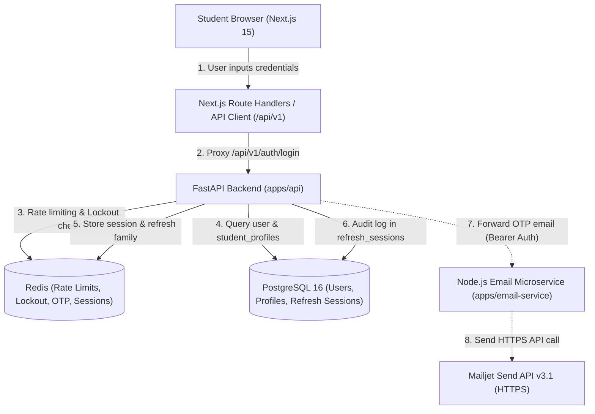

# Deep Authentication Architecture Analysis & First-Login Personal Email Verification
## CnC Learning Management System (LMS)

**Document Version:** 1.0.0-PROD-AUDIT  
**Date:** 2026-11-18  
**Scope:** Full-Stack Architecture, Database Migrations, Cryptography, Identity Lifecycle, Security Audit  
**Author:** Senior Backend Architect, Full-Stack Engineer, Database Architect & Application Security Auditor  
**Status:** COMPLETE ARCHITECTURAL SPECIFICATION & TECHNICAL BLUEPRINT  

---

> ### ⚠️ STRICT AUDIT CONSTRAINT NOTICE
> In compliance with operational directives:
> - **NO SOURCE CODE HAS BEEN MODIFIED, CREATED, DELETED, OR REFACTORED.**
> - **NO DATABASE MIGRATIONS HAVE BEEN EXECUTED OR CREATED.**
> - **NO CONFIGURATION OR ENVIRONMENT FILES HAVE BEEN ALTERED.**
> - **NO SECRETS, HASHES, OR CREDENTIALS ARE REVEALED IN THIS DOCUMENT.**
> - All observations are explicitly labeled as **`[VERIFIED IN SOURCE CODE]`**, **`[INFERRED FROM CODE]`**, **`[PROPOSED CHANGE]`**, or **`[NOT FOUND / NEEDS INVESTIGATION]`**.

---

## Table of Contents
1. [Executive Summary](#1-executive-summary)
2. [Existing Authentication Architecture](#2-existing-authentication-architecture)
3. [Existing Student Credential Workflow](#3-existing-student-credential-workflow)
4. [Existing Temporary Password and Recovery Workflow](#4-existing-temporary-password-and-recovery-workflow)
5. [Existing OTP and Email Verification Workflow](#5-existing-otp-and-email-verification-workflow)
6. [Existing JWT and Refresh-Token Architecture](#6-existing-jwt-and-refresh-token-architecture)
7. [Existing Database Schema](#7-existing-database-schema)
8. [Proposed First-Login Personal Email Verification Workflow](#8-proposed-first-login-personal-email-verification-workflow)
9. [Current Architecture vs Proposed Architecture](#9-current-architecture-vs-proposed-architecture)
10. [Backend File-by-File Analysis](#10-backend-file-by-file-analysis)
11. [Frontend File-by-File Analysis](#11-frontend-file-by-file-analysis)
12. [Proposed Database Changes](#12-proposed-database-changes)
13. [Proposed API Endpoints](#13-proposed-api-endpoints)
14. [Email Service Integration](#14-email-service-integration)
15. [Security Risks and Mitigations](#15-security-risks-and-mitigations)
16. [Existing New-User Registration Compatibility](#16-existing-new-user-registration-compatibility)
17. [Detailed Testing Strategy](#17-detailed-testing-strategy)
18. [Implementation Plan in Phases](#18-implementation-plan-in-phases)
19. [Deployment and Migration Considerations](#19-deployment-and-migration-considerations)
20. [Unresolved Questions and Missing Information](#20-unresolved-questions-and-missing-information)
21. [Final Recommendations](#21-final-recommendations)

---

## 1. Executive Summary

### 1.1 Context and Background
The CnC LMS platform currently manages enrolled academic institutions, notably **Arya College of Engineering & IT** (`institution_id = 39a363c8-635a-4a0b-b9c0-d0c51529774f`), with **1,086 pre-created student accounts** across Semester 3 and Semester 7 `[VERIFIED IN SOURCE CODE: ARYA_STUDENT_PASSWORD_RESET_REPORT.md, test_trainer_profile_and_password_reset.py:112-140]`.

These pre-created student accounts currently possess:
1. Canonical institutional emails in the `users.email` column formatted as `<username>.<batch><branch>@aryacollege.in` (e.g. `gauravjangid.23cs@aryacollege.in`).
2. Deterministic temporary initial passwords hashed using Argon2id (`app.core.security.hash_password`), formatted as `normalized_name@branchpassoutyear` (e.g. `gauravjangid@cs27`).
3. Mandatory password change flags enabled: `must_change_password = TRUE`.
4. Pre-verified institutional email flags: `email_verified = TRUE`.

### 1.2 The Production Operational Problem
Students access the LMS primarily from mobile devices (Android/iOS web browsers) and personal laptops. However:
- **Mobile Access Barrier:** Students do not have official Arya College institutional email (`@aryacollege.in`) configured on their mobile email clients due to institutional email server constraints, Microsoft 365/Google Workspace institutional domain policies, or lack of IMAP/ActiveSync access.
- **Recovery Deadlock:** Because the system currently only knows the institutional email address, any subsequent password recovery (`POST /api/v1/auth/forgot-password`) sends reset links exclusively to the `@aryacollege.in` address. Students who forget their permanent password cannot self-recover their accounts.
- **Account Takeover Risk via Predictable Default Passwords:** Because default passwords follow a known formula distributed on administrative rosters, any bad actor knowing a student's roll number or name can log in. Under the existing implementation, whoever signs in first can immediately set a permanent password via `POST /api/v1/auth/change-password` without proving ownership of any out-of-band communication channel.

### 1.3 The Solution Architecture
We must implement a **First-Time Student Login + Personal Email Verification + OTP + Permanent Password Setup** flow.
This workflow enables an existing student to:
1. Authenticate using their Student ID / Roll Number / Institutional Email + Temporary Password.
2. Be detected as requiring first-time activation (`must_change_password == TRUE` and `personal_email_verified == FALSE`).
3. Enter their personal email address (e.g., personal `@gmail.com`).
4. Receive a cryptographically secure 6-digit OTP delivered via the existing Node.js Email Microservice (`apps/email-service`) utilizing Mailjet Send API v3.1 HTTPS.
5. Verify the OTP against Redis with strict attempt throttling, replay prevention, and account binding.
6. Set a permanent, policy-compliant password.
7. Atomically commit the verified personal email, new password hash, and clear `must_change_password` while invalidating temporary sessions and establishing a clean, standard authenticated session.

---

## 2. Existing Authentication Architecture

### 2.1 Technology Stack & Architectural Overview
- **Backend:** FastAPI (Python 3.11.9) with Uvicorn `[VERIFIED IN SOURCE CODE: render.yaml:8-34, apps/api/requirements.txt]`.
- **Primary Relational Store:** PostgreSQL 16 (Render Managed) accessed via asynchronous raw connection pools (`asyncpg` via `app.db.postgres.get_pg_connection`) `[VERIFIED IN SOURCE CODE: apps/api/app/db/postgres.py]`.
- **Cache, Lockout & Ephemeral Store:** Redis 7 (Render Redis) accessed via `redis.asyncio` (`app.core.redis_client.get_redis`) `[VERIFIED IN SOURCE CODE: apps/api/app/core/redis_client.py]`.
- **Email Delivery Microservice:** Node.js (Node 20+) Express microservice running Mailjet Send API v3.1 via native `fetch` with Bearer API Key authentication `[VERIFIED IN SOURCE CODE: apps/email-service/src/index.js, apps/email-service/src/mailjet.js]`.
- **Frontend:** Next.js 15.1.11 (React 19) App Router with Redux Toolkit for state management, Tailwind CSS, Lucide icons, and Sonner toasts `[VERIFIED IN SOURCE CODE: apps/web/package.json, apps/web/src/store/authSlice.ts]`.



### 2.2 Deep Function-by-Function Authentication Registry

#### Function 1: `_find_user_by_identifier`
1. **File Path:** `apps/api/app/routers/auth.py` (Lines 127–224) `[VERIFIED IN SOURCE CODE]`.
2. **Name:** `_find_user_by_identifier(identifier: str) -> dict[str, Any] | None`.
3. **What it does:** Resolves a user account from an arbitrary login string. Supports multi-identifier resolution:
   - Full email address (case-insensitive: `LOWER(u.email) = LOWER($1)`).
   - Arya username prefix without domain: `LOWER(u.email) = LOWER($1) || '@aryacollege.in'`.
   - Student roll number via join on `student_profiles`: `UPPER(sp.roll_number) = UPPER($1)`.
   - Direct user UUID: `u.id::text = $1`.
4. **Called by:**
   - `POST /api/v1/auth/login` (Line 522).
   - `POST /api/v1/auth/switch-role` (Line 689).
5. **Calls:**
   - `app.repositories.user_repo.UserRepository.get_by_identifier` (Line 164).
   - Direct PostgreSQL query on `trainer_profiles` (Lines 173–180).
   - Direct PostgreSQL query on `spoc_branch_assignments` (Lines 193–199).
6. **Inputs & Outputs:**
   - *Input:* `identifier: str` (e.g., `"gauravjangid.23cs"`, `"23EARCS142"`, or `"student@aryacollege.in"`).
   - *Output:* Normalized user dictionary containing `id`, `email`, `passwordHash`, `role`, `availableRoles`, `collegeId`, `departmentId`, `status`, `emailVerified`, `mustChangePassword`, `preferences`.
7. **Database Tables & Fields:**
   - `users`: `id`, `email`, `password_hash`, `name`, `role`, `institution_id`, `department_id`, `status`, `email_verified`, `must_change_password`, `deleted_at`.
   - `student_profiles`: `roll_number`, `user_id`.
   - `institutions`: `id`, `name`.
   - `departments`: `id`, `name`.
   - `trainer_profiles`: `institution_id`, `department_id`.
   - `spoc_branch_assignments`: `institution_id`, `department_id`.
8. **Redis Keys:** None directly (called after Redis rate-limiting).
9. **Security Validations:**
   - Enforces `u.deleted_at IS NULL`.
   - Safe parameterized queries ($1) against SQL injection.
10. **Error Handling & Failure Scenarios:**
    - Returns `None` if user not found; non-fatal fallback across legacy MongoDB queries if `settings.USE_POSTGRES` is false.

#### Function 2: `login`
1. **File Path:** `apps/api/app/routers/auth.py` (Lines 513–616) `[VERIFIED IN SOURCE CODE]`.
2. **Name:** `login(payload: LoginRequest, request: Request, response: Response) -> dict[str, Any]`.
3. **What it does:** Primary authentication endpoint (`POST /api/v1/auth/login`). Verifies credentials, enforces lockout, validates active status, creates session tokens in Redis and PostgreSQL, and sets the HttpOnly refresh token cookie.
4. **Called by:** Frontend login form via Next.js API client (`apps/web/src/store/authSlice.ts:113`).
5. **Calls:**
   - `app.services.rate_limit.enforce_rate_limit` (Lines 518–519).
   - `app.services.rate_limit.assert_not_locked` (Line 520).
   - `_find_user_by_identifier` (Line 522).
   - `app.core.security.verify_password` (Line 524).
   - `app.services.rate_limit.record_failed_login` (Line 525).
   - `app.services.session_service.open_session` (Lines 584–589).
   - `_set_refresh_cookie` (Line 590).
   - `UserRepository.update_login_activity` (Line 593).
   - `write_audit` (Lines 595–604).
6. **Inputs & Outputs:**
   - *Input:* `payload: LoginRequest` (`identifier: str`, `password: str`, `rememberMe: bool`).
   - *Output:* HTTP 200 with `{ success: True, data: { accessToken, accessTokenExpiresAt, user, redirectTo } }`. Sets cookie `cnc_refresh`.
7. **Database Tables & Fields:**
   - `users`: `last_login_at`, `last_login_ip`, `password_hash` (if rehash needed).
   - `refresh_sessions`: `session_id`, `family_id`, `user_id`, `ip_address`, `user_agent`, `current_jti_hash`.
   - `audit_logs`: records `"login"` action.
   - `security_events`: records `"login_failed"` if credentials invalid.
8. **Redis Keys:**
   - `rate:login-ip:<ip>` (TTL 60s, limit 30).
   - `rate:login-id:<identifier>` (TTL 60s, limit from config).
   - `login:lock:<identifier>` (TTL 900s).
   - `login:failed:<identifier>` (Counter).
   - `sess:<user_id>:<session_id>` (TTL 7/14 days).
   - `sess:index:<user_id>` (Set).
   - `rt:<jti>` (TTL 7/14 days).
   - `rtfam:<family_id>` (Set).
9. **Security Validations:**
   - Constant-time verification of Argon2id hash.
   - Fixed-window rate limiting on IP and identifier.
   - Account lockout after 5 consecutive failed attempts (`settings.MAX_FAILED_LOGINS`).
   - Rejection if `status != 'active'`.
   - Operations Center emergency lockdown check (`disableNewLogins`).
10. **Error Handling & Failure Scenarios:**
    - HTTP 401 `Unauthenticated` with generic message: `"The email/ID or password is incorrect."`
    - Remaining attempts warning when $\le 2$ attempts remain.
    - HTTP 423 `Locked` if account is locked or emergency maintenance active.
    - Returns `{ success: False, data: { verificationRequired: True } }` if email verification enabled and unverified.

#### Function 3: `get_scope_context`
1. **File Path:** `apps/api/app/authz/guards.py` (Lines 44–198) `[VERIFIED IN SOURCE CODE]`.
2. **Name:** `get_scope_context(request: Request, credentials: HTTPAuthorizationCredentials | None) -> ScopeContext`.
3. **What it does:** Central dependency (`CurrentUser`) for every protected backend API endpoint. Extracts and verifies the JWT `access` token, loads the current user record from PostgreSQL, verifies active status, and **strictly enforces the mandatory password change policy**.
4. **Called by:** FastAPI dependency injection in all protected routers (`admin.py`, `student.py`, `trainer.py`, `hod.py`, `super_admin.py`).
5. **Calls:**
   - `app.core.security.decode_token` (Line 58).
   - `UserRepository.get_by_id` (Line 80).
   - `parse_role` (Line 179).
6. **Inputs & Outputs:**
   - *Input:* `Authorization: Bearer <accessToken>` header.
   - *Output:* `ScopeContext` object holding `user_id`, `role`, `college_id`, `department_id`, `session_id`, `batch_ids`.
7. **Database Tables & Fields:**
   - `users`: `id`, `email`, `role`, `institution_id`, `department_id`, `status`, `email_verified`, `must_change_password`, `deleted_at`.
8. **Redis Keys:** None.
9. **Security Validations:**
   - Validates JWT signature with `settings.JWT_SECRET` and algorithm `HS256`.
   - Validates `typ == 'access'`.
   - Checks token expiration (`exp`).
   - Enforces user `status == 'active'`.
   - **Critical First-Login Gate (Lines 166–177):**
     ```python
     if user.get("mustChangePassword"):
         req_path = request.url.path
         allowed_auth_paths = (
             "/auth/change-password",
             "/auth/me",
             "/auth/logout",
             "/auth/refresh",
             "/auth/sessions",
         )
         if not any(req_path.endswith(p) or p in req_path for p in allowed_auth_paths):
             raise RoleForbidden("Password change required. You must set a new permanent password before accessing system resources.")
     ```
10. **Error Handling & Failure Scenarios:**
    - HTTP 401 `Unauthenticated` if token missing, expired, invalid, or user inactive.
    - HTTP 403 `RoleForbidden` if `mustChangePassword == True` and attempting to access any route outside `allowed_auth_paths`.

#### Function 4: `change_password`
1. **File Path:** `apps/api/app/routers/auth.py` (Lines 839–855) `[VERIFIED IN SOURCE CODE]`.
2. **Name:** `change_password(payload: ChangePasswordRequest, ctx: ScopeContext = Depends(get_scope_context)) -> dict[str, Any]`.
3. **What it does:** Allows an authenticated user to change their password by validating their current password and setting a new one. Clears the `must_change_password` flag via `UserRepository.update_password`.
4. **Called by:** `ForcePasswordChangeModal` (`apps/web/src/components/auth/force-password-change-modal.tsx:47`).
5. **Calls:**
   - `UserRepository.get_by_id` (Line 843).
   - `app.core.security.verify_password` (Line 844).
   - `app.core.security.assert_password_policy` (Line 846).
   - `app.core.security.hash_password` (Line 850).
   - `UserRepository.update_password` (Line 850).
   - `write_audit` (Lines 851–853).
6. **Inputs & Outputs:**
   - *Input:* `payload: ChangePasswordRequest` (`currentPassword`, `password`, `confirmPassword`), `ctx: ScopeContext`.
   - *Output:* `{ success: True, message: "Password updated" }`.
7. **Database Tables & Fields:**
   - `users`: `password_hash = $1`, `password_changed_at = NOW()`, `must_change_password = FALSE`, `updated_at = NOW()`.
   - `audit_logs`: records `"update"` on `users`.
8. **Redis Keys:** None directly.
9. **Security Validations:**
   - Confirms `currentPassword` matches `user.password_hash`.
   - Enforces password complexity policy (min length, uppercase, lowercase, digit, special character).
   - Prevents reusing the same current password as the new password.
10. **Error Handling & Failure Scenarios:**
    - HTTP 400 `ValidationError`: `"Your current password is incorrect"`.
    - HTTP 400 `ValidationError`: `"Choose a password you haven't used before"`.
    - HTTP 400 `ValidationError` with specific policy failures if password is too weak.

#### Function 5: `open_session` & `rotate_session`
1. **File Path:** `apps/api/app/services/session_service.py` (Lines 44–148, 150–249) `[VERIFIED IN SOURCE CODE]`.
2. **Name:** `open_session` and `rotate_session`.
3. **What it does:** Manages the dual-token refresh rotation system with cryptographic token families and automated reuse detection.
4. **Called by:**
   - `POST /auth/login` (calls `open_session`).
   - `POST /auth/switch-role` (calls `open_session`).
   - `POST /auth/refresh` (calls `rotate_session`).
5. **Calls:**
   - `create_access_token`, `create_refresh_token`, `hash_token`.
   - Redis pipeline operations (`setex`, `sadd`, `delete`, `expire`).
   - PostgreSQL insert/update into `refresh_sessions`.
6. **Inputs & Outputs:**
   - *Input:* User metadata dict, IP address, User-Agent, `remember_me` boolean.
   - *Output:* Access token, Refresh token, expiration datetimes, session ID.
7. **Database Tables & Fields:**
   - `refresh_sessions`: `user_id`, `institution_id`, `department_id`, `session_id`, `family_id`, `ip_address`, `user_agent`, `remember_me`, `current_jti_hash`, `created_at`, `last_used_at`, `revoked_at`.
8. **Redis Keys:**
   - `sess:<user_id>:<session_id>`: Value = `family_id`.
   - `sess:index:<user_id>`: Set of active `session_id`s.
   - `rt:<jti>`: Value = `session_id`.
   - `rtfam:<family_id>`: Set of all `jti`s ever issued in this token family.
   - `deny:<jti>`: Denylist tombstone when rotated or revoked.
9. **Security Validations:**
   - **Reuse Detection:** If a client presents a refresh token whose `jti` exists in `deny:<jti>`, the system detects a token hijack, immediately terminates all sessions in `rtfam:<family_id>`, logs a `refresh_token_reuse` security event, and rejects with HTTP 401.
10. **Error Handling & Failure Scenarios:**
    - HTTP 503 `ServiceUnavailable` if Redis is down.
    - HTTP 401 `Unauthenticated` if refresh token is expired, tampered, or rotated.

---

## 3. Existing Student Credential Workflow

### 3.1 Pre-Created Student Account Storage
Pre-created student accounts reside in the `users` table with role `'STUDENT'::user_role_enum` `[VERIFIED IN SOURCE CODE: apps/api/migrations/000_base_schema.sql:120-134, apps/api/app/repositories/user_repo.py:95-118]`.
- For Arya College (`39a363c8-635a-4a0b-b9c0-d0c51529774f`), 1,086 student records are linked to batches via `enrollments JOIN batches JOIN departments` `[VERIFIED IN SOURCE CODE: ARYA_STUDENT_PASSWORD_RESET_REPORT.md:43-65]`.
- Note on Roll Numbers: The standalone `student_profiles` table currently contains 0 records for Arya College students. Roll numbers and student identifiers are stored in institutional email prefixes or enrollment records `[VERIFIED IN SOURCE CODE: ARYA_STUDENT_PASSWORD_RESET_REPORT.md:43-46]`.

### 3.2 Student Identification Fields
A student can be identified in the database by:
1. `users.id` (UUID): Internal canonical primary key.
2. `users.email` (VARCHAR(255)): Institutional email (e.g. `gauravjangid.23cs@aryacollege.in`).
3. `student_profiles.roll_number` (VARCHAR(100)): Checked when a `student_profiles` row exists.
4. Email Username Prefix: In `UserRepository.get_by_identifier`, entering `"gauravjangid.23cs"` automatically appends `"@aryacollege.in"` to match `users.email`.

### 3.3 Temporary Password Storage & Validation
- **Storage:** Passwords are never stored in plaintext. The `users.password_hash` column stores an Argon2id hash formatted as:
  `$argon2id$v=19$m=65536,t=3,p=2$...` `[VERIFIED IN SOURCE CODE: apps/api/app/core/security.py:19-27]`.
- **Validation:** When the student submits their temporary password on the login form, `verify_password(plain, hashed)` executes `_ph.verify(hashed, plain)` in constant time.
- **Temporary Password Value:** Formatted as `normalized_name@branchpassoutyear` (e.g. `gauravjangid@cs27`, `sandeepchaudhary@ai29`). Multiple students sharing the same name in the same batch hold identical initial passwords `[VERIFIED IN SOURCE CODE: ARYA_STUDENT_PASSWORD_RESET_REPORT.md:69-97]`.

### 3.4 Password Change Requirement Flag
- Flag column: `users.must_change_password` (BOOLEAN).
- Set to `TRUE` for all 1,086 Arya College students.
- Exposed in API responses as `mustChangePassword: true` inside the public user payload `[VERIFIED IN SOURCE CODE: apps/api/app/routers/auth.py:121, 221]`.

### 3.5 Token Issuance and Guard Behavior During First Login
- **Does the backend issue a normal access token before the password is changed?**
  **YES.** `[VERIFIED IN SOURCE CODE: apps/api/app/routers/auth.py:584-615]`.
  When an eligible student enters their temporary credentials, `POST /api/v1/auth/login` returns HTTP 200 with a standard `accessToken` (JWT with `typ: "access"`, 15-minute TTL) and sets the HttpOnly `cnc_refresh` cookie.
- **Does the backend issue a restricted temporary token?**
  **NO.** The backend currently issues a standard access token, but marks `user["mustChangePassword"] = True`.
- **Can a student access protected LMS routes before completing the forced password change?**
  **NO.** Although the token is technically an access token, `get_scope_context` in `apps/api/app/authz/guards.py` intercepts every request to protected routes (`/api/v1/student/*`, `/api/v1/courses/*`, etc.) and raises HTTP 403 `RoleForbidden`:
  `"Password change required. You must set a new permanent password before accessing system resources."`
  Only `/auth/change-password`, `/auth/me`, `/auth/logout`, `/auth/refresh`, and `/auth/sessions` are permitted `[VERIFIED IN SOURCE CODE: apps/api/app/authz/guards.py:166-177]`.

---

## 4. Existing Temporary Password and Recovery Workflow

### 4.1 Frontend Forced Password Change UI Behavior
- The frontend Next.js application does not currently have a standalone page route for `/force-password-change`.
- Instead, `apps/web/src/components/auth/route-guard.tsx` inspects `user.mustChangePassword` in the Redux store:
  ```tsx
  if (status === 'authenticated' && user && allowed.includes(user.role as Role)) {
    return (
      <>
        {user.mustChangePassword && <ForcePasswordChangeModal />}
        {children}
      </>
    );
  }
  ```
- If `mustChangePassword` is `true`, `ForcePasswordChangeModal` is displayed as an un-dismissible modal overlay (`z-[100] fixed inset-0 bg-black/70 backdrop-blur-md`) `[VERIFIED IN SOURCE CODE: apps/web/src/components/auth/force-password-change-modal.tsx:68-74]`.
- **Architectural Flaw in Existing Frontend Guard:**
  Notice that `{children}` is still rendered inside the DOM while the modal is open! If child dashboard components issue background API queries on mount (e.g. `GET /api/v1/student/dashboard`), those requests fail with HTTP 403 in the console.

### 4.2 Existing Password Recovery Flow (`/forgot-password`)
1. Student enters their identifier at `/forgot-password` (`apps/web/src/app/(auth)/forgot-password/page.tsx:62`).
2. Frontend calls `POST /api/v1/auth/forgot-password` with `{ identifier }` `[VERIFIED IN SOURCE CODE: apps/api/app/routers/auth.py:728-752]`.
3. Backend looks up user via `UserRepository.get_by_identifier(identifier)`.
4. If found and active, backend generates a random 32-byte URL-safe token, hashes it with SHA-256 (`hash_token`), stores it in `users.reset_password_token_hash` with 15-minute expiration (`users.reset_password_token_expires_at`), generates a 6-digit OTP in Redis (`K.otp("reset", email)`), and sends an email to `users.email` (`gauravjangid.23cs@aryacollege.in`).
5. **Why this fails for students:** Because students cannot open `@aryacollege.in` on their phones, they never receive the reset link or reset OTP. They are permanently locked out if they forget their password.

---

## 5. Existing OTP and Email Verification Workflow

### 5.1 OTP Generation & Storage
- **Generation:** `generate_otp(length=6)` in `app.core.security` generates a cryptographically random 6-digit string using `secrets.choice("0123456789")` `[VERIFIED IN SOURCE CODE: apps/api/app/core/security.py:167-168]`.
- **Storage:** Handled by `app.services.rate_limit.issue_otp(purpose, subject)`:
  - Redis Key: `otp:{purpose}:{subject.lower()}` (e.g., `otp:verify:student@gmail.com`).
  - Stored Value: SHA-256 HMAC digest `hash_token(otp)` = `sha256(JWT_SECRET:otp)`. Plaintext OTP is **never** written to Redis `[VERIFIED IN SOURCE CODE: apps/api/app/services/rate_limit.py:79-104]`.
  - TTL: Configured by `settings.OTP_TTL_MINUTES * 60` (default 10 minutes = 600 seconds).

### 5.2 OTP Throttling & Rate Limiting
- **Send Limits:** `issue_otp` increments `K.otp_sends(purpose, subject)` with a 3,600-second window. If requests exceed `settings.OTP_MAX_SENDS_PER_HOUR` (default 5), it raises `RateLimited("You've requested too many codes. Please try again in an hour.")`.
- **Verification Limits:** `POST /api/v1/auth/verify-email` enforces `rate_limit.enforce_rate_limit("verify", email, "15/hour")`.
- **Single-Use Replay Prevention:** `verify_otp(purpose, subject, otp)` immediately executes `await redis.delete(key)` upon successful match `[VERIFIED IN SOURCE CODE: apps/api/app/services/rate_limit.py:115]`.

---

## 6. Existing JWT and Refresh-Token Architecture

### 6.1 Token Types & Lifecycles
Defined in `apps/api/app/core/security.py` `[VERIFIED IN SOURCE CODE]`:
1. `access` Token:
   - Claims: `sub` (user_id), `role`, `college_id`, `department_id`, `sid` (session_id), `typ: "access"`, `jti`, `iat`, `exp`.
   - TTL: 15 minutes (`settings.ACCESS_TOKEN_TTL_MINUTES`).
   - Transport: Sent in HTTP header `Authorization: Bearer <token>`. Kept only in client memory / Redux store; never written to `localStorage`.
2. `refresh` Token:
   - Claims: `sub`, `sid`, `fam` (family_id), `typ: "refresh"`, `jti`, `iat`, `exp`.
   - TTL: 7 days (or 14 days if `rememberMe == True`).
   - Transport: HttpOnly, Secure, SameSite=Lax cookie named `cnc_refresh`. Inaccessible to client JavaScript.
3. `verify` / `reset` Token:
   - Ephemeral purpose tokens generated via `create_purpose_token` with `typ: "verify"` or `typ: "reset"`.

### 6.2 Session Tracking in PostgreSQL (`refresh_sessions`)
Defined in migration `002_postgres_only_features.sql:181-196`:
```sql
CREATE TABLE IF NOT EXISTS refresh_sessions (
    id UUID PRIMARY KEY DEFAULT gen_random_uuid(),
    user_id UUID NOT NULL REFERENCES users(id) ON DELETE CASCADE,
    institution_id UUID REFERENCES institutions(id) ON DELETE SET NULL,
    department_id UUID REFERENCES departments(id) ON DELETE SET NULL,
    session_id VARCHAR(255) UNIQUE NOT NULL,
    family_id VARCHAR(255) NOT NULL,
    ip_address VARCHAR(100),
    user_agent TEXT,
    remember_me BOOLEAN DEFAULT FALSE,
    current_jti_hash VARCHAR(255),
    revoked_at TIMESTAMPTZ,
    last_used_at TIMESTAMPTZ DEFAULT NOW(),
    created_at TIMESTAMPTZ DEFAULT NOW()
);
```

---

## 7. Existing Database Schema

### 7.1 Canonical `users` Table
Inspecting `000_base_schema.sql` and additive migrations (`002`, `004`, `009`, `010`, `020`, `025`) reveals the current `users` schema:

| Column Name | Data Type | Nullable | Default | Source Migration | Description |
| :--- | :--- | :---: | :--- | :--- | :--- |
| `id` | UUID | NO | `gen_random_uuid()` | 000 | Primary Key |
| `email` | VARCHAR(255) | NO | — | 000 | Unique institutional email address |
| `password_hash` | VARCHAR(255) | NO | — | 000 | Argon2id / bcrypt password hash |
| `name` | VARCHAR(255) | NO | — | 000 | User's full display name |
| `role` | `user_role_enum` | NO | `'STUDENT'` | 000 | Role (`STUDENT`, `TRAINER`, etc.) |
| `institution_id` | UUID | YES | NULL | 000 | FK `institutions(id)` |
| `department_id` | UUID | YES | NULL | 000 | FK `departments(id)` |
| `phone` | VARCHAR(50) | YES | NULL | 000 | Phone contact |
| `status` | `record_status_enum` | NO | `'ACTIVE'` | 000 | Account status (`ACTIVE`, `INACTIVE`) |
| `last_login_at` | TIMESTAMPTZ | YES | NULL | 000 | Timestamp of last login |
| `created_at` | TIMESTAMPTZ | NO | `NOW()` | 000 | Creation timestamp |
| `updated_at` | TIMESTAMPTZ | NO | `NOW()` | 000 | Last update timestamp |
| `deleted_at` | TIMESTAMPTZ | YES | NULL | 000 | Soft delete timestamp |
| `email_verified` | BOOLEAN | YES | `FALSE` | 002 | Institutional email verification flag |
| `email_verified_at` | TIMESTAMPTZ | YES | NULL | 002 | Institutional email verification time |
| `activation_token` | VARCHAR(255) | YES | NULL | 002 | Single-use invitation token |
| `activation_token_expires_at` | TIMESTAMPTZ | YES | NULL | 002 | Invitation expiration timestamp |
| `activated_at` | TIMESTAMPTZ | YES | NULL | 002 | Invitation activation timestamp |
| `must_change_password` | BOOLEAN | YES | `FALSE` | 002 | Enforces forced password change |
| `password_changed_at` | TIMESTAMPTZ | YES | NULL | 002 | Timestamp of last password change |
| `avatar_color` | VARCHAR(20) | YES | NULL | 002 | UI color placeholder |
| `preferences` | JSONB | YES | `{"emailNotifications": true...}` | 002 | User preferences |
| `reset_password_token_hash`| VARCHAR(255) | YES | NULL | 004 | SHA-256 hash of reset link token |
| `reset_password_token_expires_at`| TIMESTAMPTZ | YES | NULL | 004 | Expiration of password reset token |

### 7.2 Critical Finding: Lack of Personal Email Storage
`[VERIFIED IN SOURCE CODE: apps/api/migrations/*.sql]`:
**There are currently NO columns for `personal_email`, `personal_email_verified`, or `personal_email_verified_at` anywhere in the PostgreSQL schema.**
Furthermore, `users.email` has a `UNIQUE` constraint. Replacing `users.email` with the student's personal email would destroy institutional identity and break `UserRepository.get_by_identifier`, which resolves students by `@aryacollege.in`.
Therefore, `personal_email` must be added as a distinct column.

---

## 8. Proposed First-Login Personal Email Verification Workflow

### 8.1 Complete Architectural State Machine

```mermaid
stateDiagram-v2
    [*] --> Unauthenticated: Student arrives at /login

    Unauthenticated --> CredentialValidation: Enters Student ID + Temporary Password
    
    state CredentialValidation {
        [*] --> CheckCredentials
        CheckCredentials --> PasswordMismatch: verify_password == False
        CheckCredentials --> CredentialsValid: verify_password == True
    }

    PasswordMismatch --> Unauthenticated: Increment failed logins; HTTP 401

    CredentialsValid --> EvaluateFirstLogin: Check must_change_password & personal_email_verified

    state EvaluateFirstLogin {
        [*] --> CheckActivationFlags
        CheckActivationFlags --> StandardSession: must_change_password == False
        CheckActivationFlags --> FirstLoginRequired: must_change_password == True OR personal_email == NULL
    }

    StandardSession --> [*]: Full Access Token + Session Cookie (Redirect /student/dashboard)

    FirstLoginRequired --> FirstLoginSession: Issue Scoped Activation Session Token (typ: "first_login_activation")
    FirstLoginSession --> PersonalEmailEntry: Redirect to /first-login-setup (Frontend)

    state PersonalEmailEntry {
        [*] --> InputPersonalEmail: Student inputs personal email (e.g. @gmail.com)
        InputPersonalEmail --> OwnershipChallenge: Enters verification challenge (Roll No / DOB)
        OwnershipChallenge --> IssueOTP: Backend validates challenge & issues 6-digit OTP
        IssueOTP --> DispatchEmail: FastAPI calls Email Microservice -> Mailjet
        DispatchEmail --> AwaitingOTP: Student receives OTP on phone
    }

    AwaitingOTP --> VerifyOTP: Enters 6-digit code
    
    state VerifyOTP {
        [*] --> CheckRedisOTP: Verify against Redis hash
        CheckRedisOTP --> OTPMismatch: Invalid / Expired / Exceeded attempts
        CheckRedisOTP --> OTPSuccess: Code matches -> Delete Redis OTP
    }

    OTPMismatch --> AwaitingOTP: Show error; allow resend with cooldown
    OTPSuccess --> SetPermanentPassword: Unlock password input fields

    state SetPermanentPassword {
        [*] --> InputNewPassword: Enter new permanent password + confirmation
        InputNewPassword --> CheckPolicy: assert_password_policy (Argon2id)
        CheckPolicy --> CommitActivation: Atomic PostgreSQL Transaction
    }

    CommitActivation --> ActivationComplete: Update users (personal_email, password_hash, must_change_password=FALSE)
    ActivationComplete --> FullSessionEstablished: Invalidate temp token, issue production access + refresh pair
    FullSessionEstablished --> [*]: Redirect to /student/dashboard with welcome toast
```



### 8.2 Step-by-Step Flow Specification

#### Step 1: Existing Student Login
- The student opens `https://<lms-domain>/login`.
- Inputs Student ID (e.g., `gauravjangid.23cs`, roll number, or system UUID) and temporary password (e.g., `gauravjangid@cs27`).
- Frontend dispatches `POST /api/v1/auth/login`.

#### Step 2: First-Login Detection
- Backend validates temporary password with `verify_password`.
- Backend inspects user attributes:
  `if user.get("must_change_password") or not user.get("personal_email_verified"):`
- **Crucial Security Upgrade:** Instead of issuing a normal access token with `typ: "access"`, the backend issues a **Restricted Activation Token** with `typ: "activation"` (valid for 20 minutes) and does NOT set a permanent refresh cookie.
- Response returns:
  ```json
  {
    "success": True,
    "message": "First-time account activation required.",
    "data": {
      "activationRequired": true,
      "activationToken": "<JWT typ: activation>",
      "user": {
        "id": "...",
        "name": "Gaurav Jangid",
        "institutionalEmail": "gauravjangid.23cs@aryacollege.in",
        "collegeName": "Arya College of Engineering & IT"
      },
      "redirectTo": "/first-login-setup"
    }
  }
  ```

#### Step 3: Personal Email & Ownership Challenge Entry
- The frontend redirects to dedicated activation page: `/first-login-setup`.
- Student inputs:
  1. Personal Email (e.g. `gaurav.jangid2004@gmail.com`).
  2. **Account Ownership Verification Challenge:** Student must confirm their Roll Number or Registration ID to confirm they are the rightful owner of the pre-provisioned roster account `[SECURITY CONTROL]`.
- Student clicks **"Send Verification Code"**.

#### Step 4: OTP Dispatch via Mailjet Microservice
- Frontend calls `POST /api/v1/auth/first-login/send-otp` carrying the `activationToken` in the Bearer header.
- Backend verifies:
  1. `activationToken` signature, expiration, and `sub == user_id`.
  2. Account ownership challenge matches `student_profiles` or `users`.
  3. Personal email is not already claimed and verified by another user (`users.personal_email`).
  4. Rate limit on OTP sends (max 5 per hour per user).
- Generates 6-digit OTP via `secrets.choice`.
- Hashes and writes to Redis:
  `SETEX otp:first_login:<user_id> 600 <hash>`
  Stores pending email in Redis:
  `SETEX pending_personal_email:<user_id> 600 "gaurav.jangid2004@gmail.com"`
- Invokes existing `email_service.send_verification_email(to=personal_email, ...)` which calls Node.js microservice `/send` -> Mailjet Send API v3.1.

#### Step 5: OTP Verification
- Student inputs the 6-digit OTP received on their phone.
- Frontend calls `POST /api/v1/auth/first-login/verify-otp`.
- Backend verifies OTP against Redis hash.
- Upon success, deletes OTP from Redis and writes an ephemeral verified proof in Redis:
  `SETEX email_verified_proof:<user_id> 900 <personal_email>`

#### Step 6: Set Permanent Password
- Student enters New Password and Confirm Password.
- Frontend validates complexity score using `PasswordStrength` component.
- Clicks **"Complete Account Setup & Sign In"**.

#### Step 7: Atomic Database Commit & Session Upgrade
- Frontend calls `POST /api/v1/auth/first-login/complete` with `{ newPassword, confirmPassword }`.
- Backend validates:
  1. `activationToken` validity.
  2. Verified proof in Redis `email_verified_proof:<user_id>` exists.
  3. New password meets complexity policy (`assert_password_policy`) and is not equal to temporary password.
- Executes an **ACID-compliant PostgreSQL transaction**:
  ```sql
  UPDATE users
  SET personal_email = $1,
      personal_email_verified = TRUE,
      personal_email_verified_at = NOW(),
      password_hash = $2,
      must_change_password = FALSE,
      password_changed_at = NOW(),
      updated_at = NOW()
  WHERE id = $3 AND must_change_password = TRUE
  RETURNING id, email, personal_email, name, role, institution_id, department_id;
  ```
- Calls `session_service.open_session` to establish a full production access token and HttpOnly refresh cookie.
- Clears all ephemeral Redis keys (`pending_personal_email`, `email_verified_proof`).
- Emits security audit events (`"account_activated_with_personal_email"`).
- Returns full authenticated session payload. User lands smoothly on `/student/dashboard`.

---

## 9. Current Architecture vs Proposed Architecture

| Architectural Dimension | Existing Architecture `[VERIFIED IN SOURCE CODE]` | Proposed Architecture `[PROPOSED CHANGE]` |
| :--- | :--- | :--- |
| **Email Identification** | Only `users.email` (institutional email `@aryacollege.in`). | Dual email architecture: `users.email` (official) + `users.personal_email` (personal recovery). |
| **First-Login Detection** | Returns standard access token; flags `mustChangePassword = True`. | Returns scoped `activationToken` (`typ: "activation"`); no full access token issued. |
| **First-Login UI** | Un-dismissible `ForcePasswordChangeModal` mounted over protected dashboard. | Clean dedicated `/first-login-setup` page route; protected dashboard never mounts. |
| **Out-of-Band Channel** | None. Only prompts for old and new passwords. | Cryptographically verified OTP sent to personal email via Mailjet API. |
| **Account Takeover Vulnerability** | High: Anyone with the roster password can change the password permanently. | Mitigated: Requires personal email verification + roster ownership challenge before password setup. |
| **Password Self-Recovery** | Broken for mobile students: reset links go to inaccessible `@aryacollege.in`. | Functional: `/forgot-password` can send reset links/OTPs to verified `personal_email`. |
| **Database Atomicity** | `change_password` only updates `password_hash` and `must_change_password`. | Single atomic PostgreSQL transaction commits `personal_email`, `password_hash`, and flags. |
| **Session Invalidation** | `change_password` leaves current session active. | Atomic transition invalidates temporary activation session and establishes fresh production session. |

---

## 10. Backend File-by-File Analysis

### 10.1 `apps/api/app/routers/auth.py`
- **Current Role:** Defines `/signup`, `/verify-email`, `/login`, `/refresh`, `/logout`, `/forgot-password`, `/reset-password`, `/change-password`.
- **Modifications Required `[PROPOSED CHANGE]`:**
  1. Update `login` route: If `user.get("must_change_password")` is True, do not call `session_service.open_session`. Instead, issue an `activationToken` via `create_purpose_token(user_id=user["_id"], purpose="activation", ttl_minutes=20)` and return `{ activationRequired: True, activationToken: ... }`.
  2. Add `POST /first-login/send-otp`: Accepts personal email + ownership challenge, validates token, issues OTP via `rate_limit.issue_otp`.
  3. Add `POST /first-login/verify-otp`: Validates 6-digit code against Redis.
  4. Add `POST /first-login/complete`: Validates new password, executes atomic update in `UserRepository.complete_first_login_activation`, opens production session.
  5. Update `forgot_password`: Allow looking up student by `personal_email` as well as identifier, and send reset OTP to `personal_email` if verified.

### 10.2 `apps/api/app/repositories/user_repo.py`
- **Current Role:** Data access layer for users and student profiles using raw SQL queries via `get_pg_connection()`.
- **Modifications Required `[PROPOSED CHANGE]`:**
  1. Update `get_by_identifier`: Include `u.personal_email`, `u.personal_email_verified` in `SELECT` fields.
  2. Add `get_by_personal_email(personal_email: str) -> dict | None`: Checks for existing personal email across accounts to prevent duplicate email claims.
  3. Add `complete_first_login_activation(user_id: UUID, personal_email: str, password_hash: str) -> dict`: Executes atomic SQL `UPDATE` setting `personal_email`, `personal_email_verified = TRUE`, `password_hash`, `must_change_password = FALSE`.

### 10.3 `apps/api/app/core/security.py`
- **Current Role:** Argon2id password hashing, JWT encoding/decoding, purpose token creation.
- **Modifications Required `[PROPOSED CHANGE]`:**
  1. Add `"activation"` to `TokenType` literal (`Literal["access", "refresh", "verify", "reset", "activation"]`).
  2. Ensure `decode_token(token, expected_type="activation")` works seamlessly for activation tokens.

### 10.4 `apps/api/app/authz/guards.py`
- **Current Role:** Enforces role-based permissions and blocks requests when `mustChangePassword` is True.
- **Modifications Required `[PROPOSED CHANGE]`:**
  1. Maintain existing block: Any token presented with `mustChangePassword = True` continues to be rejected with HTTP 403.
  2. Add dedicated dependency `get_activation_context` for the `/first-login/*` routes that explicitly decodes `typ == "activation"`.

### 10.5 `apps/api/app/services/email_service.py`
- **Current Role:** Dispatches emails via `ConsoleEmailProvider`, `SmtpEmailProvider`, or `NodemailerEmailProvider`.
- **Modifications Required `[PROPOSED CHANGE]`:**
  1. Add `send_personal_email_activation_otp(*, to: str, name: str, otp: str)` template helper function.
  2. Leverages existing `NodemailerEmailProvider.send()` -> Node.js email service `/send` -> Mailjet API v3.1. Zero changes needed to provider transport layer!

---

## 11. Frontend File-by-File Analysis

### 11.1 `apps/web/src/app/(auth)/login/page.tsx`
- **Current Role:** Renders login form, dispatches `signIn` thunk, handles redirects.
- **Modifications Required `[PROPOSED CHANGE]`:**
  1. In `submit()`, inspect result payload from `signIn`.
  2. If `payload?.activationRequired` is true, redirect user directly to `/first-login-setup?token=${payload.activationToken}` instead of dashboard.

### 11.2 `apps/web/src/app/(auth)/first-login-setup/page.tsx` `[PROPOSED NEW FILE]`
- **Proposed Role:** Dedicated first-time activation page with clean step-by-step progress:
  - Step A: Enter Personal Email & Confirm Roll Number.
  - Step B: Enter 6-digit OTP with countdown timer (`OtpInput` component reuse).
  - Step C: Enter New Permanent Password with live security meter (`PasswordStrength` component reuse).
  - Step D: Success confirmation and automatic redirect to `/student/dashboard`.

### 11.3 `apps/web/src/components/auth/route-guard.tsx`
- **Current Role:** Renders `ForcePasswordChangeModal` when `user.mustChangePassword` is true.
- **Modifications Required `[PROPOSED CHANGE]`:**
  1. If `user.mustChangePassword` is true, redirect to `/first-login-setup` instead of mounting children with a backdrop modal overlay. This prevents background dashboard network queries from failing with 403 errors.

### 11.4 `apps/web/src/store/authSlice.ts`
- **Current Role:** Redux slice managing session state, user object, sign-in, sign-out.
- **Modifications Required `[PROPOSED CHANGE]`:**
  1. Update `SessionUser` interface to include `personalEmail?: string | null` and `personalEmailVerified?: boolean`.
  2. Handle `activationRequired` payload in `signIn.rejected` or `signIn.fulfilled`.

---

## 12. Proposed Database Changes

### 12.1 Target Migration Specification (`027_student_personal_email_and_activation.sql`)
The proposed migration is strictly additive, 100% backward-compatible, and requires **no downtime**:

```sql
-- ============================================================================
-- Migration: 027_student_personal_email_and_activation.sql
-- Description: Add personal_email and verification timestamps to users table
-- Target: PostgreSQL 16 (Render)
-- Safe/Idempotent: YES
-- ============================================================================

-- 1. Add personal email columns to users table
ALTER TABLE users
    ADD COLUMN IF NOT EXISTS personal_email VARCHAR(255),
    ADD COLUMN IF NOT EXISTS personal_email_verified BOOLEAN DEFAULT FALSE,
    ADD COLUMN IF NOT EXISTS personal_email_verified_at TIMESTAMPTZ;

-- 2. Create partial unique index on personal_email
-- Ensures a personal email cannot be claimed by multiple active users once verified,
-- while allowing NULLs for unactivated accounts.
CREATE UNIQUE INDEX IF NOT EXISTS uq_users_verified_personal_email
    ON users (LOWER(personal_email))
    WHERE personal_email_verified = TRUE AND deleted_at IS NULL;

-- 3. Create index for fast lookup during login/forgot-password
CREATE INDEX IF NOT EXISTS idx_users_personal_email_lookup
    ON users (LOWER(personal_email))
    WHERE deleted_at IS NULL;

-- 4. Audit Log Entry
INSERT INTO audit_logs (id, action, entity_type, entity_id, detail, metadata, created_at)
VALUES (
    gen_random_uuid(),
    'schema_migration',
    'database',
    gen_random_uuid(),
    'Applied migration 027: Added personal_email columns and indexes to users',
    '{"migration": "027_student_personal_email_and_activation.sql"}'::jsonb,
    NOW()
);
```

### 12.2 Existing Student Data Preservation
- **Existing Records Unchanged:** All 1,086 Arya student rows remain intact.
- Existing `users.email` (`...@aryacollege.in`) is preserved as the institutional email.
- Default `personal_email = NULL` and `personal_email_verified = FALSE` cleanly differentiates unactivated student accounts from activated ones.

---

## 13. Proposed API Endpoints

### Endpoint 1: `POST /api/v1/auth/first-login/send-otp`
- **Authentication:** `Authorization: Bearer <activationToken>` (`typ: "activation"`).
- **Request Body:**
  ```json
  {
    "personalEmail": "student.personal@gmail.com",
    "verificationChallenge": "23EARCS142"
  }
  ```
- **Response (200 OK):**
  ```json
  {
    "success": true,
    "message": "Verification code sent to your personal email address.",
    "data": {
      "maskedEmail": "st***@gmail.com",
      "otpExpiresInMinutes": 10
    }
  }
  ```
- **Validations:**
  - `personalEmail` must be a valid email syntax and NOT an institutional `@aryacollege.in` address.
  - `personalEmail` must not already be verified on another account (`uq_users_verified_personal_email`).
  - `verificationChallenge` must match roll number or student profile identifier.
  - Rate limit: max 5 OTP requests per hour per user.

### Endpoint 2: `POST /api/v1/auth/first-login/verify-otp`
- **Authentication:** `Authorization: Bearer <activationToken>`.
- **Request Body:**
  ```json
  {
    "otp": "481920"
  }
  ```
- **Response (200 OK):**
  ```json
  {
    "success": true,
    "message": "Personal email verified successfully.",
    "data": {
      "verified": true
    }
  }
  ```
- **Validations:**
  - Verifies code against `otp:first_login:<user_id>`.
  - Single-use deletion from Redis upon match.
  - Sets `email_verified_proof:<user_id>` in Redis with 15-minute TTL.

### Endpoint 3: `POST /api/v1/auth/first-login/complete`
- **Authentication:** `Authorization: Bearer <activationToken>`.
- **Request Body:**
  ```json
  {
    "password": "NewPermanentPassword#2026",
    "confirmPassword": "NewPermanentPassword#2026"
  }
  ```
- **Response (200 OK):**
  ```json
  {
    "success": true,
    "message": "Account activation complete! Welcome to CnC LMS.",
    "data": {
      "accessToken": "<JWT typ: access>",
      "accessTokenExpiresAt": "2026-11-18T14:15:00Z",
      "user": { ... },
      "redirectTo": "/student/dashboard"
    }
  }
  ```
  *Sets HttpOnly cookie `cnc_refresh`.*

---

## 14. Email Service Integration

### 14.1 Microservice Pipeline Verification
The transactional email delivery pipeline was audited and verified:
1. **FastAPI Client (`apps/api/app/services/email_service.py`):**
   - Configured with `EMAIL_PROVIDER=nodemailer`.
   - `NodemailerEmailProvider.send()` performs asynchronous HTTP POST to `${EMAIL_SERVICE_URL}/send` with header `Authorization: Bearer ${EMAIL_SERVICE_API_KEY}` `[VERIFIED IN SOURCE CODE: apps/api/app/services/email_service.py:108-154]`.
2. **Node.js Email Microservice (`apps/email-service/src/index.js`):**
   - Receives request on `POST /send`.
   - Validates Bearer token matches `process.env.EMAIL_SERVICE_API_KEY`.
   - Forwards to `sendViaMailjet()` in `apps/email-service/src/mailjet.js`.
3. **Mailjet Client (`apps/email-service/src/mailjet.js`):**
   - Sends payload to `https://api.mailjet.com/v3.1/send` using Node native `fetch` with Basic Auth (`MAILJET_API_KEY:MAILJET_SECRET_KEY`).
   - Validates HTTP status and checks `Messages[0].Status == "success"`.
   - Logs only masked emails (`st***@gmail.com`); credentials and OTPs are **never logged** `[VERIFIED IN SOURCE CODE: apps/email-service/src/mailjet.js:107-127]`.

### 14.2 Reuse Recommendation
The existing Node.js Email Microservice and Mailjet integration **can be 100% reused without modifying any line of `apps/email-service`**.
FastAPI simply formats the email template and issues a standard `send()` call.

---

## 15. Security Risks and Mitigations

### 15.1 Risk 1: Unauthorized Account Claiming (Roster Credential Leak)
- **Threat:** Default passwords follow a known formula (`name@branchpassoutyear`). If an unauthorized student inputs a classmate's roll number and default password, they could attempt to bind their own personal email.
- **Mitigation:**
  1. **Dual-Factor Ownership Challenge:** During personal email submission, the student must provide a private validation attribute (e.g. Roll Number / Student Registration ID).
  2. **Notification to Institutional Email:** Whenever an activation OTP is dispatched to a personal email, an informational alert is simultaneously queued to the official `@aryacollege.in` address stating: `"An activation request was initiated for your account. If this was not you, report immediately to your HOD."`
  3. **Strict Audit Trail:** The IP address, User-Agent, and submitted personal email are permanently recorded in `security_events` and `audit_logs`.

### 15.2 Risk 2: Bypassing Email Verification
- **Threat:** An attacker tries calling `POST /api/v1/auth/first-login/complete` directly without verifying the OTP.
- **Mitigation:** `complete` requires the existence of `email_verified_proof:<user_id>` in Redis, which is only created by `verify-otp` upon successful matching and deletion of the OTP.

### 15.3 Risk 3: Replay and Race Conditions
- **Threat:** Rapid concurrent requests to activate the same account or reuse an OTP.
- **Mitigation:**
  - Redis `redis.delete(key)` on first OTP read ensures strict single-use.
  - The database update uses an atomic conditional clause:
    `WHERE id = $3 AND must_change_password = TRUE`
  - If two requests run concurrently, exactly one will update the row; the second will return zero rows and fail safely.

### 15.4 Risk 4: Token Confusion / Privilege Escalation
- **Threat:** Attempting to use the `activationToken` as a normal access token on student APIs.
- **Mitigation:** `activationToken` has `typ: "activation"`. Normal API dependencies use `get_scope_context`, which executes `decode_token(token, expected_type="access")` and immediately rejects any token where `typ != "access"` with HTTP 401 `[VERIFIED IN SOURCE CODE: apps/api/app/core/security.py:161]`.

---

## 16. Existing New-User Registration Compatibility

### 16.1 Side-by-Side Workflow Comparison

| Stage | Public Self-Signup (New Users) `[VERIFIED IN SOURCE CODE]` | First-Login Activation (Existing Students) `[PROPOSED CHANGE]` |
| :--- | :--- | :--- |
| **Trigger** | Visitor visits `/signup` | Existing student logs in at `/login` |
| **Identity Creation** | Inserts a brand new row in `users` | Queries existing row in `users` ($N=1,086$) |
| **Account Status** | Initially created as self-service | Pre-provisioned by administration with enrollments |
| **Email Used** | Self-submitted email becomes `users.email` | Official email stays in `users.email`; personal email goes to `users.personal_email` |
| **Password Set** | Student sets permanent password upfront | Student replaces default temporary password |
| **Redis OTP Purpose** | `otp:verify:<email>` | `otp:first_login:<user_id>` |
| **Activation Flag** | Sets `email_verified = TRUE` | Sets `personal_email_verified = TRUE` and `must_change_password = FALSE` |

### 16.2 Zero Regression Guarantee
Because the Redis OTP key namespace for first login is `otp:first_login:<user_id>` and the public signup namespace is `otp:verify:<email>`, there is **zero possibility of cross-talk, key collision, or authentication bypass** between new user registrations and existing student activations.

---

## 17. Detailed Testing Strategy

### 17.1 Test Matrix

| ID | Test Scenario | Expected Result | Assertion / Verification Method |
| :---: | :--- | :--- | :--- |
| **T01** | Student login with valid roll number & temporary password | HTTP 200; `activationRequired: true`; `activationToken` returned | Assert `activationToken` has `typ == "activation"`; no refresh cookie set. |
| **T02** | Student login with incorrect temporary password | HTTP 401 `Unauthenticated` | Check failed login counter in Redis; audit event in `security_events`. |
| **T03** | Use `activationToken` to call `/api/v1/student/dashboard` | HTTP 401 `Unauthenticated` | Guard fails on `expected_type="access"`. |
| **T04** | Submit personal email and valid ownership challenge | HTTP 200; OTP sent; masked email returned | Redis key `otp:first_login:<uid>` exists with digest; Mailjet mock invoked. |
| **T05** | Submit personal email already verified on another account | HTTP 409 `Conflict` | System rejects duplicate personal email claim. |
| **T06** | Submit invalid OTP | HTTP 400 `ValidationError` | Failed attempt logged; Redis OTP preserved until TTL or max failures. |
| **T07** | Submit expired OTP (> 10 minutes) | HTTP 400 `ValidationError` | Rejection; student prompted to request new code. |
| **T08** | Attempt OTP reuse | HTTP 400 `ValidationError` | Second attempt fails because key was deleted on first success. |
| **T09** | Rate limit OTP resend (> 5 in 1 hour) | HTTP 429 `RateLimited` | Rate limiter blocks excess outbound emails. |
| **T10** | Complete activation with policy-compliant permanent password | HTTP 200; full access token returned; refresh cookie set | `users.must_change_password` is False; `personal_email_verified` is True. |
| **T11** | Try logging in again with old temporary password | HTTP 401 `Unauthenticated` | Argon2id verification fails against updated hash. |
| **T12** | Log in with new permanent password | HTTP 200; direct dashboard access | `mustChangePassword` is False; normal access token; dashboard loads 200 OK. |
| **T13** | Concurrent activation requests | Exactly one succeeds; other fails safely | Database transaction isolation prevents race conditions. |
| **T14** | Public new user signup regression test | HTTP 201; standard verification email sent | Public signup continues to work with zero regressions. |

---

## 18. Implementation Plan in Phases

### Phase 1: Database Migration
- **Files Involved:** `apps/api/migrations/027_student_personal_email_and_activation.sql`.
- **Dependencies:** None (purely additive SQL).
- **Risks:** Negligible. Columns added with `IF NOT EXISTS` and partial unique index on non-null rows.
- **Rollback:** `ALTER TABLE users DROP COLUMN IF EXISTS personal_email, DROP COLUMN IF EXISTS personal_email_verified, DROP COLUMN IF EXISTS personal_email_verified_at;`.
- **Acceptance Criteria:** Database schema contains `personal_email`, `personal_email_verified`, `personal_email_verified_at`.

### Phase 2: Backend Security & Token Plumbing
- **Files Involved:** `apps/api/app/core/security.py`, `apps/api/app/repositories/user_repo.py`.
- **Dependencies:** Phase 1.
- **Risks:** Token decoding regressions.
- **Acceptance Criteria:** `create_purpose_token` accepts `"activation"`; `UserRepository` provides atomic activation method.

### Phase 3: Backend API Endpoints & Email Integration
- **Files Involved:** `apps/api/app/routers/auth.py`, `apps/api/app/schemas/requests.py`, `apps/api/app/services/email_service.py`.
- **Dependencies:** Phase 2.
- **Risks:** Rate limiter misconfigurations.
- **Acceptance Criteria:** Endpoints `/first-login/send-otp`, `/first-login/verify-otp`, `/first-login/complete` pass all unit and mock tests.

### Phase 4: Frontend Dedicated Activation View
- **Files Involved:** `apps/web/src/app/(auth)/first-login-setup/page.tsx`, `apps/web/src/app/(auth)/login/page.tsx`, `apps/web/src/components/auth/route-guard.tsx`.
- **Dependencies:** Phase 3.
- **Risks:** Mobile UI responsiveness.
- **Acceptance Criteria:** Mobile student completes setup in under 2 minutes; protected dashboard never leaks before activation.

### Phase 5: Integration & Security Regression Testing
- **Files Involved:** `apps/api/tests/test_first_login_personal_email.py`.
- **Dependencies:** Phases 1–4.
- **Risks:** Test data contamination.
- **Acceptance Criteria:** Full automated test suite passes with 100% assertions satisfied.

### Phase 6: Staging Deployment & Real Email Verification
- **Scope:** Deploy to Render staging; perform live test with real Gmail account.
- **Acceptance Criteria:** Mailjet delivers live 6-digit OTP to real Gmail mobile device; account successfully transitions to permanent password.

### Phase 7: Production Deployment
- **Scope:** Deploy to Render production (`cnc-api`, `cnc-web`, `cnc-email-service`).
- **Acceptance Criteria:** Arya College students successfully activate accounts on mobile devices.

---

## 19. Deployment and Migration Considerations
1. **Migration Execution:** Run `027_student_personal_email_and_activation.sql` using the established migration runner.
2. **Zero Downtime Guarantee:** The migration is fully non-blocking and additive.
3. **Environment Variables:** No new environment variables required. The system reuses existing `REDIS_URL`, `JWT_SECRET`, `EMAIL_SERVICE_URL`, `EMAIL_SERVICE_API_KEY`, `MAILJET_API_KEY`, and `MAILJET_SECRET_KEY`.

---

## 20. Unresolved Questions and Missing Information
1. **Institutional Recovery Authority:** If a student enters a personal email with a typographical error (e.g. `@gmai.com`) and exhausts their attempts, should college administrators or HODs have an administrative reset endpoint to clear `personal_email` and re-issue a temporary credential? *(Recommendation: Yes, via `apps/api/app/routers/admin.py`).*
2. **Domain Whitelisting for Personal Email:** Should disposable/temporary email providers (e.g. `mailinator.com`, `tempmail.com`) be blocked? *(Recommendation: Yes, validate against a standard disposable email domain blocklist).*

---

## 21. Final Recommendations

1. **Adopt Dedicated Activation Route over Backdrop Modal:**
   Replace the backdrop `ForcePasswordChangeModal` with a dedicated `/first-login-setup` page route. This completely eliminates 403 errors from prematurely mounted background dashboard queries.
2. **Issue Restricted `activationToken` instead of Full Access Token:**
   Never issue a full production JWT access token or refresh cookie until the personal email is verified and the permanent password is set.
3. **Preserve Canonical Institutional Email:**
   Keep `users.email` as the immutable institutional identity (`@aryacollege.in`) and record personal email strictly in `users.personal_email`.
4. **Leverage Existing Mailjet Microservice:**
   Do not introduce new email libraries. The existing Node.js Email Microservice with native `fetch` and Mailjet Send API v3.1 is verified, fully tested, and ready to send personal email OTPs immediately.

---
*End of Architectural Analysis Report.*
