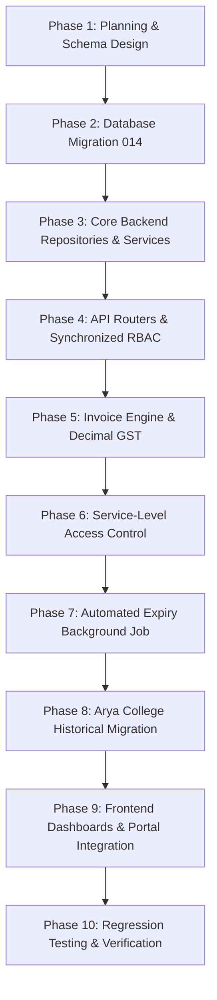

# WINNERS CREEK LMS — MASTER IMPLEMENTATION PLAN
## Semester-Based Fee Management, Payment Verification, Historical Migration, Invoice Generation & Access Control

**Document Version:** 1.0.0  
**Target Platform:** Winners Creek LMS (FastAPI + PostgreSQL 16 + Next.js 15)  
**Target Environment:** Production (`origin/main`, Render Backend, Vercel Frontend)  
**Author:** Principal Software Architect & Application Security Engineer  

---

## 1. Executive Summary & Architecture Overview

This implementation plan establishes a comprehensive, production-ready, semester-based subscription, payment verification, and service-level access management system for Winners Creek LMS.

### Core Architectural Principles
1. **Account Status vs. Service Access Status Decoupling:**
   - A student's user account (`users.status`) remains `ACTIVE`. Account suspension or login freezing for fee default is strictly prohibited.
   - Students whose semester payment is overdue or pending retain full access to their dashboard, profile, payment checkout, previously enrolled historical content, completed assessment results, past reports, and historical invoices.
   - Access restriction applies granularly at the service layer: newly assigned course lessons, new assessments, and paid AI practice tools are gated with HTTP 403 `{"detail": "Payment required for current semester", "code": "SEMESTER_PAYMENT_REQUIRED"}`.
2. **Synchronized Dual-Tier Verification:**
   - Both Super Admin (global scope) and College Admin (college scope) share a single authoritative payment record in PostgreSQL.
   - Verification by either administrator automatically transitions the payment status to `VERIFIED`, updates access validity, generates an official GST invoice exactly once, and emits an immutable audit event. Both dashboards reflect this state instantly without dual approvals.
3. **Strict RBAC & Tenant Isolation:**
   - **Super Admin:** Global monitoring, payment verification, rejection, manual access activation, course fee/GST/semester scheduling, refund management.
   - **College Admin:** College-scoped monitoring, payment verification, rejection, manual access activation, invoice downloads.
   - **HOD:** Department-scoped read-only visibility into student payment and validity status. Zero verification, rejection, or refund controls.
   - **Trainer:** Strictly **zero** payment UI routes, navigation links, or API endpoints.
   - **Student:** Self-service viewing of dues, GST-inclusive breakdowns, UTR submission, payment history, and invoice downloads.
4. **GST-Inclusive Decimal Arithmetic:**
   - Flat fee of ₹5,850 inclusive of 6.36% GST:
     $$\text{Taxable Amount} = \frac{5850}{1 + 0.0636} = \frac{5850}{1.0636} \approx 5500.18825... \rightarrow ₹5,500.19$$
     $$\text{GST Amount} = 5850 - 5500.19 = ₹349.81$$
     $$\text{Total Invoice Amount} = 5500.19 + 349.81 = ₹5,850.00$$
   - Strict Python `Decimal` with `ROUND_HALF_UP` prevents floating-point inaccuracies.
5. **Arya College Historical Payment Integrity:**
   - Cohort: 1,087 students (625 in Semester 3, 462 in Semester 7) in Arya College (`39a363c8-635a-4a0b-b9c0-d0c51529774f`).
   - Payment Pattern:
     - Sem 3: Paid (₹5,850) $\rightarrow$ Paid record & Official GST Invoice.
     - Sem 4: Included $\rightarrow$ Status `INCLUDED_PERIOD` (No fake paid invoice).
     - Sem 5: Included $\rightarrow$ Status `INCLUDED_PERIOD` (No fake paid invoice).
     - Sem 6: Paid (₹5,850) $\rightarrow$ Paid record & Official GST Invoice (for 7th sem cohort).
     - Sem 7: Included $\rightarrow$ Status `INCLUDED_PERIOD` (No fake paid invoice).
     - Sem 8: Included $\rightarrow$ Status `INCLUDED_PERIOD` (No fake paid invoice).
   - Preserves all 325 existing real UTRs (`TXN_ARYA_...`) and genuine timestamps without fabrication.

---

## 2. Implementation Phasing & Work Breakdown



### Phase 1: Pre-Implementation Planning Documents (Completed)
- `IMPLEMENTATION_PLAN.md`
- `DATABASE_MIGRATION_PLAN.md`
- `HISTORICAL_DATA_MIGRATION_PLAN.md`
- `REGRESSION_TEST_PLAN.md`

### Phase 2: Database Migration (`014_semester_fee_management_and_access_control.sql`)
1. Extend `courses` table:
   - `payment_frequency` (`VARCHAR(32)` DEFAULT `'SEMESTER'`): `SEMESTER`, `YEARLY`, `MONTHLY`, `QUARTERLY`, `ONE_TIME`, `CUSTOM`.
   - `gst_rate` (`NUMERIC(5,2)` DEFAULT `6.36`).
   - `gst_inclusive` (`BOOLEAN` DEFAULT `TRUE`).
   - `semester_fee` (`NUMERIC(10,2)` DEFAULT `5850.00`).
   - `current_semester_number` (`INTEGER` DEFAULT 1).
   - `current_period_start_date` (`DATE`).
   - `current_period_end_date` (`DATE`).
   - `payment_due_date` (`DATE`).
   - `grace_period_days` (`INTEGER` DEFAULT 7).
   - `refund_policy_config` (`JSONB`).
2. Create `course_semester_configs` table:
   - Tracks semester-by-semester scheduling per course: `course_id`, `semester_number`, `semester_name`, `academic_year`, `start_date`, `end_date`, `payment_due_date`, `fee_amount`, `is_active`.
   - Unique constraint on `(course_id, semester_number, academic_year)`.
3. Enhance `payments` table:
   - Add `institution_id` (UUID FK to `institutions.id`).
   - Add `verified_by_role` (`VARCHAR(32)`: `SUPER_ADMIN`, `COLLEGE_ADMIN`, `SYSTEM`).
   - Add `verification_source` (`VARCHAR(32)`: `PORTAL_ACTION`, `HISTORICAL_MIGRATION`, `API`).
   - Add `academic_year` (`VARCHAR(16)`).
   - Add `payment_frequency` (`VARCHAR(32)`).
   - Add `taxable_amount` (`NUMERIC(10,2)`).
   - Add `gst_amount` (`NUMERIC(10,2)`).
   - Add `gst_rate` (`NUMERIC(5,2)`).
   - Add `rejection_reason` (`TEXT`).
   - Unique index on `utr` where `utr IS NOT NULL AND status != 'REJECTED'`.
4. Enhance `enrollment_periods` table:
   - Add `period_status` (`VARCHAR(32)`: `PAID`, `INCLUDED_PERIOD`, `MANUAL_OVERRIDE`, `EXEMPT`).
   - Add `migration_status` (`VARCHAR(32)`: `MIGRATED`, `LEGACY`, `NATIVE`).
   - Add `migrated_at` (`TIMESTAMPTZ`).
   - Add `migration_source` (`VARCHAR(64)`).
   - Add `historical_payment_date_available` (`BOOLEAN`).
   - Add `historical_verification_status` (`VARCHAR(32)`).
   - Add `historical_record_notes` (`TEXT`).
   - Add `activation_source` (`VARCHAR(32)`: `PAYMENT_VERIFICATION`, `MANUAL_ADMIN_APPROVAL`, `INCLUDED_HISTORICAL_CYCLE`).
5. Create `invoices` table:
   - `id` UUID PK.
   - `invoice_number` (`VARCHAR(64)` UNIQUE NOT NULL).
   - `payment_id` (UUID FK `payments.id`, NULLABLE for direct activations).
   - `enrollment_id` (UUID FK `enrollments.id` NOT NULL).
   - `participant_user_id` (UUID FK `users.id` NOT NULL).
   - `institution_id` (UUID FK `institutions.id` NOT NULL).
   - `course_id` (UUID FK `courses.id` NOT NULL).
   - `semester_number` (`INTEGER` NOT NULL).
   - `academic_year` (`VARCHAR(16)` NOT NULL).
   - `taxable_amount` (`NUMERIC(10,2)` NOT NULL).
   - `gst_rate` (`NUMERIC(5,2)` NOT NULL).
   - `gst_amount` (`NUMERIC(10,2)` NOT NULL).
   - `total_amount` (`NUMERIC(10,2)` NOT NULL).
   - `status` (`VARCHAR(32)` DEFAULT `'ISSUED'`): `ISSUED`, `VOID`, `CREDITED`.
   - `issued_at` (`TIMESTAMPTZ` NOT NULL DEFAULT NOW()).
   - `pdf_path` (`TEXT`).
   - `generation_source` (`VARCHAR(32)`: `VERIFICATION`, `HISTORICAL_MIGRATION`, `ADMIN`).
   - `metadata` (`JSONB`).
6. Create `refund_requests` table:
   - `id` UUID PK.
   - `payment_id` (UUID FK `payments.id` NOT NULL).
   - `enrollment_id` (UUID FK `enrollments.id` NOT NULL).
   - `institution_id` (UUID FK `institutions.id` NOT NULL).
   - `user_id` (UUID FK `users.id` NOT NULL).
   - `original_amount` (`NUMERIC(10,2)` NOT NULL).
   - `refund_percentage` (`NUMERIC(5,2)` NOT NULL).
   - `calculated_refund_amount` (`NUMERIC(10,2)` NOT NULL).
   - `actual_refund_amount` (`NUMERIC(10,2)`).
   - `days_since_activation` (`INTEGER` NOT NULL).
   - `reason` (`TEXT` NOT NULL).
   - `status` (`VARCHAR(32)` DEFAULT `'REQUESTED'`): `REQUESTED`, `APPROVED`, `REJECTED`, `PROCESSED`.
   - `processed_by_user_id` (UUID FK `users.id`).
   - `processed_at` (`TIMESTAMPTZ`).
   - `notes` (`TEXT`).
7. Update `enrollments.access_status`:
   - Valid statuses: `ACTIVE`, `INACTIVE`, `EXPIRED`, `SUSPENDED`, `RESTRICTED`.

---

## 3. Detailed Component Architecture

### 3.1 Course Payment & Semester Configuration (`apps/api/app/routers/super_admin.py`)
- Super Admin controls course fee structure:
  - `GET /api/v1/super-admin/courses/{id}/payment-config`
  - `PUT /api/v1/super-admin/courses/{id}/payment-config`
  - `GET /api/v1/super-admin/courses/{id}/semesters`
  - `POST /api/v1/super-admin/courses/{id}/semesters` (configure current or next semester)
  - `PUT /api/v1/super-admin/courses/{id}/semesters/{semester_id}`
- Semester configurations enforce explicit dates:
  - `semester_number` (1 to 8)
  - `start_date`
  - `end_date`
  - `payment_due_date`
  - `fee_amount`
  - Never auto-generates or invents calendar dates without Super Admin submission.

### 3.2 Synchronized Payment Verification Engine (`apps/api/app/repositories/payment_repo.py`)
- Unified verification logic:
  - Accepts `payment_id`, `verified_by_user_id`, `verified_by_role`, `notes`.
  - Transaction block executes:
    1. Lock payment row (`SELECT ... FOR UPDATE`).
    2. Check that status is `PENDING_VERIFICATION` or `PENDING`.
    3. Update `payments` row: `status = 'VERIFIED'`, `verified_by = verified_by_user_id`, `verified_by_role = verified_by_role`, `verification_source = 'PORTAL_ACTION'`, `verified_at = NOW()`.
    4. Fetch course semester config or course validity settings.
    5. Update `enrollments`: `payment_status = 'VERIFIED'`, `access_status = 'ACTIVE'`, `access_end_date = configured_end_date + grace_period`.
    6. Update or insert `enrollment_periods`: `period_status = 'PAID'`, `payment_status = 'VERIFIED'`, `activation_source = 'PAYMENT_VERIFICATION'`, `start_date`, `end_date`.
    7. Generate invoice record with unique invoice sequence (`INV-YYYY-XXXXX`), exact Decimal tax calculation.
    8. Write audit record to `payment_verification_events` / `audit_logs`.
- Rejection flow:
  - Updates `payments`: `status = 'REJECTED'`, `rejection_reason = reason`, `verified_by = verified_by_user_id`, `verified_by_role = verified_by_role`.
  - Leaves `enrollments.payment_status` as `PENDING` or `REJECTED`, retains login ability.

### 3.3 Manual Access Activation (`apps/api/app/repositories/enrollment_repo.py`)
- Allows Super Admin or College Admin to grant access without falsely recording payment as `VERIFIED`:
  - `POST /api/v1/admin/enrollments/{id}/manual-activate`
  - `POST /api/v1/super-admin/enrollments/{id}/manual-activate`
- Sets:
  - `enrollments.access_status = 'ACTIVE'`
  - `enrollments.payment_status = 'PENDING'` (or existing state)
  - `enrollments.activation_source = 'MANUAL_ADMIN_APPROVAL'`
  - `enrollments.access_end_date = manual_expiry_date`
  - Records administrator ID, justification reason, and timestamp.
  - Generates no false paid invoice.

### 3.4 GST & Professional Invoice Service (`apps/api/app/services/invoice_service.py`)
- Invoice Numbering: `INV-{YEAR}-{INSTITUTION_CODE}-{00000}`.
- Exact Arithmetic:
  ```python
  from decimal import Decimal, ROUND_HALF_UP

  total = Decimal("5850.00")
  gst_rate = Decimal("6.36")
  taxable = (total / (Decimal("1") + (gst_rate / Decimal("100")))).quantize(
      Decimal("0.01"), rounding=ROUND_HALF_UP
  )  # 5500.19
  gst = (total - taxable).quantize(Decimal("0.01"), rounding=ROUND_HALF_UP)  # 349.81
```
- Invoices are generated as professional HTML/PDF documents storing:
  - Institution branding, logo, GSTIN, and address.
  - Student full name, roll number, department, semester, academic year.
  - Course title, payment frequency, semester fee.
  - Tax breakdown: Taxable amount, GST rate (6.36%), CGST (3.18%), SGST (3.18%), total.
  - UTR number, transaction date, verification authority and date.
  - Immutability guarantee: once issued, invoice records cannot be updated; voiding requires status flag.

### 3.5 Service-Level Access Control (`apps/api/app/services/content_auth_service.py`)
- Permission Matrix:

| Permission | Student Active | Student Payment Due / Restricted | College Admin | Super Admin | Trainer |
|---|---|---|---|---|---|
| `login` | Yes | **Yes** | Yes | Yes | Yes |
| `dashboard.view` | Yes | **Yes** | Yes | Yes | Yes |
| `content.view_historical` | Yes | **Yes** | Yes | Yes | Yes |
| `reports.view_historical` | Yes | **Yes** | Yes | Yes | Yes |
| `invoices.view_download` | Yes | **Yes** | Yes | Yes | No |
| `payment.submit_utr` | Yes | **Yes** | No | No | No |
| `content.view_new` | Yes | **No** (403) | Yes | Yes | Yes |
| `assessment.attempt_new`| Yes | **No** (403) | Yes | Yes | Yes |
| `ai_practice.use` | Yes | **No** (403) | Yes | Yes | Yes |
| `payments.verify` | No | No | **Yes** (college) | **Yes** (global) | **No** |
| `payments.reject` | No | No | **Yes** (college) | **Yes** (global) | **No** |
| `refund.process` | No | No | No | **Yes** (global) | **No** |

- Backend endpoints enforcing `content_auth_service.assert_service_access()`:
  - Lessons: `GET /api/v1/student/courses/{course_id}/lessons/{lesson_id}`
  - Assessments: `POST /api/v1/student/assessments/{assessment_id}/attempt`
  - Practice / AI: `POST /api/v1/student/practice/submit`

### 3.6 Automated Semester Expiry Background Process (`apps/api/app/workers/jobs.py`)
- Job Name: `enrollment.check_validity_and_expire`
- Criteria for restriction:
  - `enrollments.access_end_date < CURRENT_DATE`
  - `access_status = 'ACTIVE'`
  - Next semester payment status is not `VERIFIED`
  - No active `MANUAL_ADMIN_APPROVAL` override covering current date
- Safe Execution:
  - Does NOT freeze students whose `access_end_date IS NULL` unless explicitly configured.
  - Transitions `access_status` to `'RESTRICTED'`.
  - Account `users.status` remains `'ACTIVE'`.
  - Creates audit record and dispatches internal notification to student.
  - Supports `--dry-run` parameter for safe administrator simulation.

### 3.7 Refund Management System
- Slabs configured in course:
  - Day 0 to 15: 100% (or configurable percentage)
  - Day 16 to 30: 50%
  - Day 31 to 60: 25%
  - Day > 60: 0%
- Super Admin processes refund requests:
  - Calculates days elapsed: `CURRENT_DATE - access_activation_date`.
  - Generates proposed refund amount.
  - On approval, creates credit note/refund log and adjusts access status.

---

## 4. Frontend Dashboards & Portal Implementations

1. **Super Admin Dashboard (`/super-admin/payments`):**
   - KPI counters: Total collected, Verified payments, Pending verification, Rejected, Restricted students.
   - Semester & College filters.
   - Global payment verification queue with UTR inspection modal, approve, and reject actions.
   - Invoice registry with download links.
   - Course semester & fee configuration UI in course detail.
2. **College Admin Dashboard (`/admin/payments`):**
   - College-scoped payment monitoring.
   - Pending UTR submission verification queue.
   - Approve / Reject / Manual Activate buttons.
   - Student semester fee validity breakdown.
   - Invoice download triggers.
3. **HOD Dashboard (`/hod/reports`, `/hod/participants`):**
   - Read-only fee status badges: `Paid`, `Pending Verification`, `Restricted`, `Included Period`.
   - Zero verification, rejection, or refund controls.
4. **Trainer Dashboard:**
   - Verify sidebar and navigation have **zero** payment or billing links.
   - Ensure student list displays course progress without payment action buttons.
5. **Student Portal (`/student/payments`):**
   - Current semester fee card: Fee amount, 6.36% GST breakdown, payment due date.
   - UTR submission form with file upload / reference text.
   - Status tracking: `PENDING_VERIFICATION`, `VERIFIED`, `REJECTED`.
   - Past invoices table with direct PDF download button.
   - Warning banner when access is restricted, with clear unblock instructions.

---

## 5. Rollout Sequence & Safety Gates

1. Write planning documentation and verify schema design.
2. Run database migration `014` against PostgreSQL.
3. Implement backend models, services, repositories, and API endpoints.
4. Run Arya College historical migration in `--preview` mode, verifying record counts:
   - 1,087 students mapped.
   - 325 existing UTRs preserved.
   - Semesters 4, 5, 7, 8 marked `INCLUDED_PERIOD` with zero fake invoices.
5. Execute Arya College historical migration with transaction safety.
6. Update frontend components and API clients.
7. Run backend test suite (`pytest apps/api/tests/ -q`), TypeScript check (`tsc --noEmit`), and frontend build (`npm run build`).
8. Compile and deliver comprehensive Final Delivery Report.
