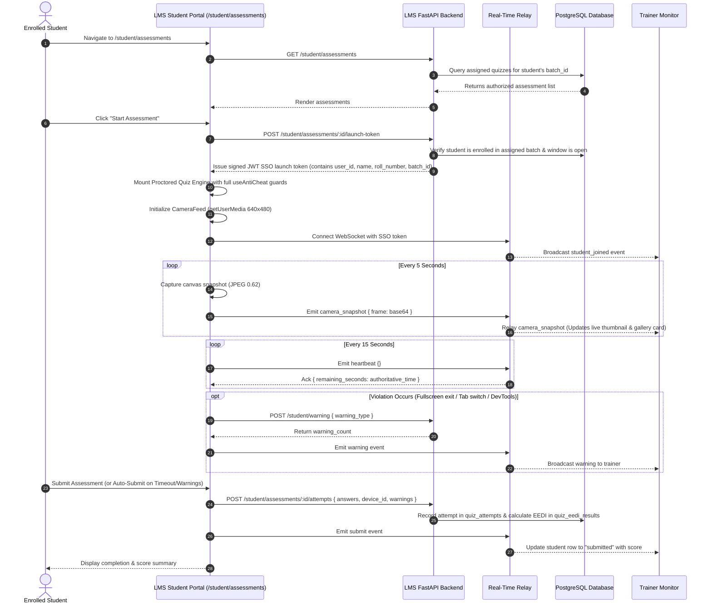
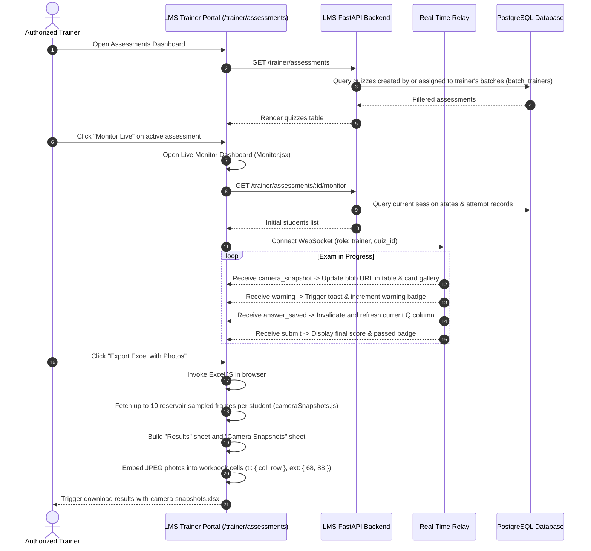

# QUIZ & LMS INTEGRATION ARCHITECTURE SPECIFICATION

**Document:** `QUIZ_LMS_INTEGRATION_ARCHITECTURE.md`  
**Architecture Status:** Production Integration Blueprint  
**Primary LMS Repository:** `C:\Users\SANDEEP\Desktop\skillsharp`  
**Original Quiz Engine:** `apps/quiz-system-v17-cloudflare/quiz-system`  

---

## 1. INTEGRATION OBJECTIVE & CORE ARCHITECTURAL INVARIANTS

The objective is to integrate the Original Quiz Platform into Winners Creek LMS **without losing, simplifying, replacing, or breaking any existing functionality**:

1. **Preserve the Original Quiz Engine:** The student-facing one-question-at-a-time interface (`QuizEngine.jsx`), question palette (`QuestionPalette.jsx`), autosave mechanism, and multi-format answer support are preserved in their entirety.
2. **Preserve the Original Camera Proctoring System:** The client-side snapshot capture (`CameraFeed.jsx`), 640x480 resolution, 0.62 JPEG compression, and 5-second interval are preserved exactly as designed.
3. **Preserve Live Supervisor Monitoring:** The real-time supervisor grid (`Monitor.jsx`) displaying student status, progress, proctoring warnings, and live camera thumbnails/gallery cards is preserved.
4. **Preserve Rich Excel & Report Exports:** The client-side `exceljs` export embedding up to 10 reservoir-sampled camera photos per student is preserved.
5. **Bridge LMS Identity, Multi-Tenancy & Batch RBAC:** Authentication, authorization, multi-batch assignment, and EEDI competency analytics are governed strictly by the LMS PostgreSQL database.

---

## 2. INTEGRATED SYSTEM TOPOLOGY

```
┌─────────────────────────────────────────────────────────────────────────────────────────┐
│                                   CLIENT LAYER (Next.js)                                │
│                                                                                         │
│   STUDENT PORTAL (/student/assessments/[id])       TRAINER PORTAL (/trainer/assessments)│
│   ├── Proctored Quiz Engine                        ├── Multi-Batch Quiz Manager         │
│   ├── Question Palette Navigation                  ├── Live Proctoring Monitor Grid     │
│   ├── CameraFeed (Webcam Snapshots)                ├── Live Camera Snapshot Gallery     │
│   ├── useAntiCheat (Fullscreen, DevTools)          ├── ExcelJS Photo Export             │
│   └── Dexie Offline Cache & Outbox                 └── Trainer EEDI Competency Report   │
└───────────────────────────▲───────────────────────────────────────▲─────────────────────┘
                            │                                       │
                 (REST & Launch Tokens)                    (Real-Time WebSockets)
                            │                                       │
┌───────────────────────────▼───────────────────────────────────────▼─────────────────────┐
│                                 SERVER & REAL-TIME LAYER                                │
│                                                                                         │
│   LMS FASTAPI BACKEND (apps/api)                    REAL-TIME RELAY SERVICE             │
│   ├── ScopeContext & JWT Auth                       ├── WebSocket Room Hub              │
│   ├── Multi-Batch Assignment Verification           ├── Low-Latency Camera Relays       │
│   ├── Server-Side Answer Grading                    ├── Proctoring Warning Broadcasts   │
│   ├── Authoritative Timer Enforcement               ├── Student Heartbeat & Presence    │
│   └── EEDI Score Calculation                        └── Cloudflare DO / Socket.IO Hub   │
└───────────────────────────▲─────────────────────────────────────────────────────────────┘
                            │
┌───────────────────────────▼─────────────────────────────────────────────────────────────┐
│                               PERSISTENT DATABASE LAYER (PostgreSQL)                    │
│                                                                                         │
│   TABLES:                                                                               │
│   ├── quizzes (Master quiz definitions, scheduling, proctoring settings)                │
│   ├── quiz_batch_assignments (Many-to-many junction to batches with tenant isolation)   │
│   ├── quiz_attempts (Student submissions, scores, warning counts, device locks)         │
│   └── quiz_eedi_results (Trainer-only competency analytics by pillar & index)           │
└─────────────────────────────────────────────────────────────────────────────────────────┘
```

---

## 3. END-TO-END WORKFLOW SEQUENCES

### 3.1 Student Workflow: SSO Launch, Proctored Execution & Submission



### 3.2 Trainer Workflow: Management, Live Monitoring & Excel Photo Export



---

## 4. IDENTITY & DATA MAPPING SPECIFICATION

### 4.1 Token Bridge Claims Mapping
When bridging LMS users into the Quiz Engine, the LMS issues a launch token (`POST /student/assessments/{quiz_id}/launch-token`):
| Token Claim | Source in LMS | Purpose in Quiz Engine |
| :--- | :--- | :--- |
| `sub` | `users.id` (UUID) | Unique student identifier |
| `name` | `users.name` (TEXT) | Displayed on exam engine & trainer monitor |
| `roll_number` | `student_profiles.roll_number` | Key identifier on monitor table and Excel report |
| `quiz_id` | `quizzes.id` (UUID) | Assessment boundary |
| `quiz_code` | `quizzes.quiz_code` | Short code reference |
| `batch_id` | `student_profiles.batch_id` | Scopes attempt to student's enrolled cohort |
| `batch_name` | `batches.name` | Displayed on trainer reports |
| `role` | `"student"` or `"trainer"` | Role-based WebSocket subscription |

### 4.2 Database Schema Alignment
The PostgreSQL database retains four core tables supporting the integrated architecture:
1. `quizzes`: Master configuration (`id`, `creator_trainer_id`, `institution_id`, `title`, `duration_minutes`, `max_score`, `settings` JSONB, `quiz_code`, `status`, `opens_at`, `closes_at`).
2. `quiz_batch_assignments`: Junction table binding assessments to multiple batches (`id`, `quiz_id`, `batch_id`, `institution_id`, `status`, `assigned_by`, `assigned_at`).
3. `quiz_attempts`: Attempt records (`id`, `quiz_id`, `student_user_id`, `batch_id`, `institution_id`, `score`, `possible`, `percentage`, `passed`, `completed_at`, `warning_count`, `device_id`, `answers` JSONB).
4. `quiz_eedi_results`: EEDI competency performance partitioned by student and batch (`id`, `quiz_id`, `student_user_id`, `batch_id`, `institution_id`, `eedi_index`, `eedi_term`, `earned_marks`, `possible_marks`, `score_percentage`).

---

## 5. REPOSITORY CODE PRESERVATION STRATEGY

| Component to Preserve | Source Location in Original Repo | Target in Integrated LMS | Integration Action |
| :--- | :--- | :--- | :--- |
| **`CameraFeed.jsx`** | `apps/quiz-system-v17-cloudflare/quiz-system/frontend/src/components/CameraFeed.jsx` | `apps/web/src/components/quiz/CameraFeed.tsx` | Preserve exact 640x480 capture, 0.62 JPEG, 5s interval, and canvas mechanics. Convert to TypeScript. |
| **`useAntiCheat.js`** | `apps/quiz-system-v17-cloudflare/quiz-system/frontend/src/hooks/useAntiCheat.js` | `apps/web/src/hooks/useAntiCheat.ts` | Preserve fullscreen, visibilitychange, devtools heuristics, right-click, and shortcut guards. |
| **`QuestionPalette.jsx`** | `apps/quiz-system-v17-cloudflare/quiz-system/frontend/src/components/QuestionPalette.jsx` | `apps/web/src/components/quiz/QuestionPalette.tsx` | Preserve question status coloring and instant jumping. |
| **`QuizEngine.jsx`** | `apps/quiz-system-v17-cloudflare/quiz-system/frontend/src/pages/student/QuizEngine.jsx` | `apps/web/src/app/student/assessments/[quizId]/page.tsx` | Replace continuous scroll with sequential one-at-a-time engine, timer, and autosave. |
| **`cameraSnapshots.js`** | `apps/quiz-system-v17-cloudflare/quiz-system/frontend/src/services/cameraSnapshots.js` | `apps/web/src/lib/quiz/cameraSnapshots.ts` | Preserve Algorithm R Reservoir Sampling (max 10 frames per student). |
| **`Monitor.jsx`** | `apps/quiz-system-v17-cloudflare/quiz-system/frontend/src/pages/admin/Monitor.jsx` | `apps/web/src/components/quiz/TrainerMonitor.tsx` | Embed real-time monitor table and live camera gallery cards into trainer portal. |
| **`Results.jsx` (ExcelJS)** | `apps/quiz-system-v17-cloudflare/quiz-system/frontend/src/pages/admin/Results.jsx` | `apps/web/src/lib/quiz/excelExport.ts` | Preserve client-side ExcelJS workbook generation embedding JPEG camera snapshots. |
