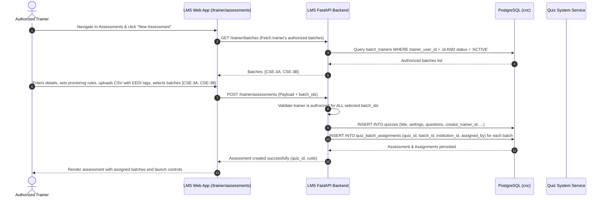
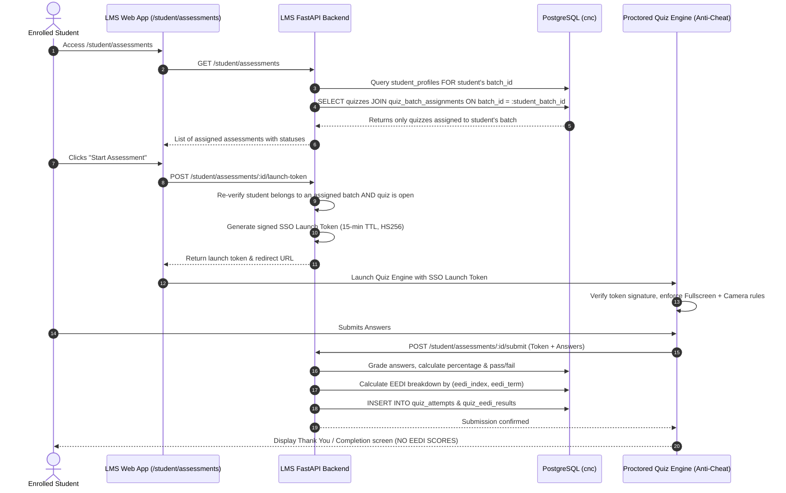

# QUIZ & LMS INTEGRATION ARCHITECTURE SPECIFICATION

**Document:** `QUIZ_LMS_INTEGRATION_ARCHITECTURE.md`  
**Status:** Approved Architectural Blueprint  
**Primary Repository:** `C:\Users\SANDEEP\Desktop\skillsharp`  
**Quiz System Path:** `C:\Users\SANDEEP\Desktop\skillsharp\apps\quiz-system-v17-cloudflare`  

---

## 1. ARCHITECTURE OVERVIEW & DESIGN PRINCIPLES

The integrated Quiz System operates as a modular, federated sub-system of the SkillSharp LMS.

### Core Architectural Invariants:
1. **Zero Degradation of Standalone Functionality:** The Quiz System can run autonomously via `start.bat` / `start.sh` or Cloudflare Worker deployment with zero dependence on the LMS.
2. **Authoritative LMS Identity & Scope:** The LMS is the authoritative provider of users, roles, institutions, and batch memberships. The Quiz System never self-assigns batch access or invents user permissions.
3. **Strict Server-Side Batch Isolation:** All quiz visibility, attempts, submissions, and analytics are scoped to explicit batch authorization rules enforced at the database level.
4. **Trainer-Only EEDI Analytics:** EEDI scores calculated from question tags are strictly sequestered from students and unauthorized users.

---

## 2. INTEGRATED DATA FLOW & SEQUENCES

### 2.1 Trainer Workflow: Create, Configure, and Assign to Batches



### 2.2 Student Workflow: Single Sign-On, Proctored Attempt, and Auto-Grading



---

## 3. DATABASE SCHEMA SPECIFICATION

The integration utilizes additive PostgreSQL tables and columns. Existing production tables (`institutions`, `batches`, `users`, `courses`, `departments`, `student_profiles`, `batch_trainers`) remain structurally unmodified.

### 3.1 Migration: `021_quiz_batch_assignments_and_eedi.sql`

```sql
-- ============================================================================
-- Migration: 021_quiz_batch_assignments_and_eedi.sql
-- Description: Additive schema for Quiz System integration:
--              - Multi-batch assignments (quiz_batch_assignments)
--              - Trainer ownership and Quiz System settings in quizzes
--              - Proctoring metadata and attempt state in quiz_attempts
--              - Trainer-only EEDI evaluation metrics in quiz_eedi_results
-- Database: PostgreSQL cnc
-- Idempotent: Yes
-- ============================================================================

-- 1. Extend quizzes table
ALTER TABLE quizzes
    ADD COLUMN IF NOT EXISTS creator_trainer_id UUID REFERENCES users(id) ON DELETE SET NULL,
    ADD COLUMN IF NOT EXISTS quiz_code VARCHAR(50) UNIQUE,
    ADD COLUMN IF NOT EXISTS settings JSONB DEFAULT '{
        "duration_minutes": 30,
        "random_questions": true,
        "random_options": true,
        "negative_marking": true,
        "passing_marks": 0,
        "maximum_students": null,
        "camera_required": true,
        "fullscreen_required": true,
        "max_warnings": 3
    }'::jsonb;

CREATE INDEX IF NOT EXISTS idx_quizzes_creator ON quizzes(creator_trainer_id);
CREATE INDEX IF NOT EXISTS idx_quizzes_code ON quizzes(quiz_code);

-- 2. Multi-batch assignments table
CREATE TABLE IF NOT EXISTS quiz_batch_assignments (
    id UUID PRIMARY KEY DEFAULT gen_random_uuid(),
    quiz_id UUID NOT NULL REFERENCES quizzes(id) ON DELETE CASCADE,
    batch_id UUID NOT NULL REFERENCES batches(id) ON DELETE CASCADE,
    institution_id UUID NOT NULL REFERENCES institutions(id) ON DELETE CASCADE,
    assigned_by UUID REFERENCES users(id) ON DELETE SET NULL,
    assigned_at TIMESTAMPTZ NOT NULL DEFAULT NOW(),
    status VARCHAR(50) NOT NULL DEFAULT 'ACTIVE',
    CONSTRAINT uq_quiz_batch_assignment UNIQUE (quiz_id, batch_id)
);

CREATE INDEX IF NOT EXISTS idx_quiz_batch_assign_batch ON quiz_batch_assignments(batch_id, status);
CREATE INDEX IF NOT EXISTS idx_quiz_batch_assign_quiz ON quiz_batch_assignments(quiz_id);
CREATE INDEX IF NOT EXISTS idx_quiz_batch_assign_inst ON quiz_batch_assignments(institution_id);

-- 3. Extend quiz_attempts table
ALTER TABLE quiz_attempts
    ADD COLUMN IF NOT EXISTS batch_id UUID REFERENCES batches(id) ON DELETE SET NULL,
    ADD COLUMN IF NOT EXISTS institution_id UUID REFERENCES institutions(id) ON DELETE SET NULL,
    ADD COLUMN IF NOT EXISTS device_id VARCHAR(255),
    ADD COLUMN IF NOT EXISTS warnings JSONB DEFAULT '[]'::jsonb,
    ADD COLUMN IF NOT EXISTS warning_count INT DEFAULT 0,
    ADD COLUMN IF NOT EXISTS status VARCHAR(50) DEFAULT 'completed',
    ADD COLUMN IF NOT EXISTS percentage NUMERIC(5,2),
    ADD COLUMN IF NOT EXISTS passed BOOLEAN DEFAULT FALSE;

CREATE INDEX IF NOT EXISTS idx_quiz_attempts_batch ON quiz_attempts(batch_id);
CREATE INDEX IF NOT EXISTS idx_quiz_attempts_inst ON quiz_attempts(institution_id);

-- 4. Isolated EEDI evaluation results table (TRAINER-ONLY)
CREATE TABLE IF NOT EXISTS quiz_eedi_results (
    id UUID PRIMARY KEY DEFAULT gen_random_uuid(),
    quiz_id UUID NOT NULL REFERENCES quizzes(id) ON DELETE CASCADE,
    attempt_id UUID NOT NULL REFERENCES quiz_attempts(id) ON DELETE CASCADE,
    student_user_id UUID NOT NULL REFERENCES users(id) ON DELETE CASCADE,
    batch_id UUID NOT NULL REFERENCES batches(id) ON DELETE CASCADE,
    institution_id UUID NOT NULL REFERENCES institutions(id) ON DELETE CASCADE,
    eedi_index INT,
    eedi_term VARCHAR(100) NOT NULL,
    earned_marks NUMERIC(5,2) NOT NULL DEFAULT 0,
    possible_marks NUMERIC(5,2) NOT NULL DEFAULT 0,
    score_percentage NUMERIC(5,2) NOT NULL DEFAULT 0,
    calculation_version VARCHAR(20) NOT NULL DEFAULT 'v1',
    created_at TIMESTAMPTZ NOT NULL DEFAULT NOW(),
    CONSTRAINT uq_quiz_attempt_eedi_term UNIQUE (attempt_id, eedi_term, eedi_index)
);

CREATE INDEX IF NOT EXISTS idx_quiz_eedi_trainer_view ON quiz_eedi_results(batch_id, quiz_id);
CREATE INDEX IF NOT EXISTS idx_quiz_eedi_student ON quiz_eedi_results(student_user_id);
CREATE INDEX IF NOT EXISTS idx_quiz_eedi_institution ON quiz_eedi_results(institution_id);
```

---

## 4. API SPECIFICATION & RBAC RULES

### 4.1 Trainer Endpoints (`/api/v1/trainer/assessments`)

1. **`GET /trainer/assessments`**
   - **Access:** `Role.TRAINER`
   - **Behavior:** Returns all quizzes created by or assigned to batches managed by this trainer. Includes list of assigned batches and submission counts.
2. **`POST /trainer/assessments`**
   - **Access:** `Role.TRAINER`
   - **Payload:** `{ title, description, durationMinutes, settings, batchIds, questions }`
   - **Verification:** Every `batchId` in `batchIds` must exist in `batch_trainers` for `trainer_user_id == ctx.user_id` and have `status = 'ACTIVE'`.
3. **`GET /trainer/assessments/{quiz_id}`**
   - **Access:** `Role.TRAINER`
   - **Verification:** Must be creator or authorized for at least one assigned batch.
4. **`PUT /trainer/assessments/{quiz_id}`**
   - **Access:** `Role.TRAINER`
   - **Verification:** Must be creator. Cannot edit while `status == 'live'`.
5. **`POST /trainer/assessments/{quiz_id}/assign-batches`**
   - **Access:** `Role.TRAINER`
   - **Payload:** `{ batchIds: string[] }`
   - **Verification:** Verifies every target batch against `batch_trainers`. Performs atomic synchronization of `quiz_batch_assignments`.
6. **`GET /trainer/assessments/{quiz_id}/results`**
   - **Access:** `Role.TRAINER`
   - **Behavior:** Returns student attempts for batches authorized to the calling trainer.
7. **`GET /trainer/assessments/{quiz_id}/eedi-analytics`**
   - **Access:** `Role.TRAINER` strictly (HTTP 403 for Students/Public)
   - **Behavior:** Returns aggregated and student-level breakdown by `eedi_index` and `eedi_term` for authorized batches.

### 4.2 Student Endpoints (`/api/v1/student/assessments`)

1. **`GET /student/assessments`**
   - **Access:** `Role.STUDENT`
   - **Behavior:** Queries `student_profiles` to resolve student's `batch_id`. Filters `quizzes` via `quiz_batch_assignments`.
2. **`GET /student/assessments/{quiz_id}`**
   - **Access:** `Role.STUDENT`
   - **Verification:** Validates `quiz_batch_assignments` for student's `batch_id`. Rejects with HTTP 403 if unassigned.
3. **`POST /student/assessments/{quiz_id}/launch-token`**
   - **Access:** `Role.STUDENT`
   - **Behavior:** Generates signed single-use SSO token for proctored launcher.
4. **`POST /student/assessments/{quiz_id}/submit`**
   - **Access:** `Role.STUDENT`
   - **Payload:** `{ answers, timeSpentSeconds, deviceId, warnings }`
   - **Behavior:** Grades quiz, checks pass/fail, updates `quiz_attempts`, computes and stores EEDI results. Returns user-facing score only (no EEDI details).

---

## 5. CSV FORMAT EXTENSION & EEDI INGESTION

### 5.1 Extended Format Specification
Columns:
- `question`: Required string
- `image`: Optional URL
- `option_a`: Required string
- `option_b`: Required string
- `option_c`: Optional string
- `option_d`: Optional string
- `correct`: Required string (references option keys: `A`, `B`, `C`, or `D`)
- `marks`: Required positive number
- `negative`: Optional non-positive number ($\le 0$)
- `eedi_index`: Optional positive integer ($\ge 0$)
- `eedi_term`: Optional sanitized string matching known EEDI pillars or competencies

### 5.2 Validation Rules:
- If a CSV lacks `eedi_index` and `eedi_term`, the import succeeds as standard MCQs.
- If `eedi_index` is non-numeric, a row-specific validation error is returned.
- If `eedi_term` contains HTML or special script tags, it is sanitized or rejected.
- During quiz export or cloning, `eedi_index` and `eedi_term` are preserved.

---

## 6. VERIFICATION & QUALITY GATES

1. **Multi-Tenant & Batch Isolation Tests:**
   - Attempting to assign Batch D by Trainer A who only has Batches B & C $\rightarrow$ **HTTP 403 Forbidden**.
   - Attempting to fetch Assessment X by Student in Batch D $\rightarrow$ **HTTP 403 Forbidden / HTTP 404**.
   - Attempting to access EEDI scores via student token $\rightarrow$ **HTTP 403 Forbidden**.
2. **Regression Verification:**
   - Standalone Quiz System starts and runs with `start.bat` / `start.sh` or local Uvicorn/Wrangler.
   - Vitest unit tests in `apps/web` pass.
   - Pytest tests in `apps/api` pass.
   - Next.js production build passes with 0 errors.
