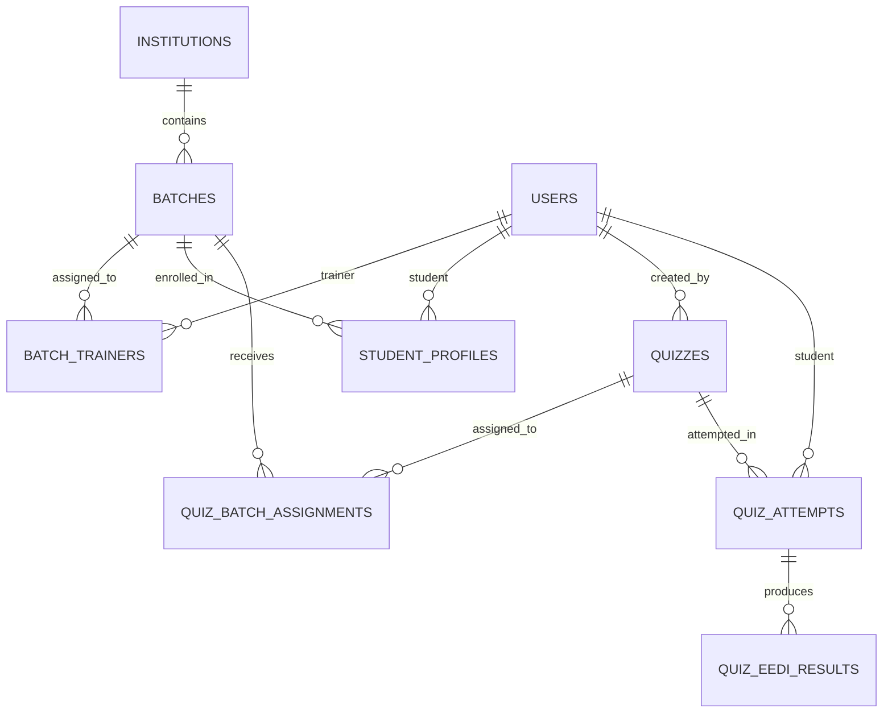
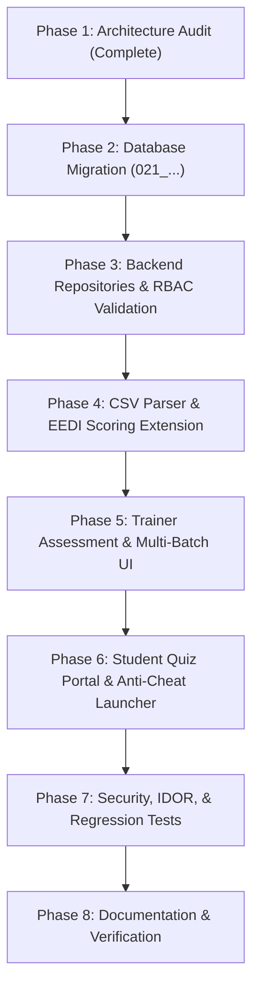

# QUIZ & LMS INTEGRATION ARCHITECTURE AUDIT

**Project:** SkillSharp / CNC LMS & Standalone Cloudflare Quiz System Integration  
**Date:** November 16, 2026  
**Status:** Complete Audit (Phase 1 Deliverable)  
**Primary Working Directory:** `C:\Users\SANDEEP\Desktop\skillsharp`  
**Quiz System Directory:** `C:\Users\SANDEEP\Desktop\skillsharp\apps\quiz-system-v17-cloudflare`  

---

## 1. EXECUTIVE SUMMARY

The SkillSharp (CNC) LMS is a production Learning Management System serving multiple institutions, departments, batches, trainers, and students. A separate, working, production-ready Quiz System exists at `apps/quiz-system-v17-cloudflare` supporting RAM-based FastAPI execution, Cloudflare Workers + Durable Objects + D1 SQLite deployment, comprehensive anti-cheat proctoring, CSV question importing, real-time live monitoring, and result exports.

This document establishes the architecture audit for integrating the existing Quiz System into the LMS without breaking its standalone deployment, without rewriting its working workflows, and while enforcing **strict batch-level access control** and **isolated EEDI scoring for trainers**.

---

## 2. LMS ARCHITECTURE & RUNTIME AUDIT

### 2.1 Technology Stack
- **Frontend:** Next.js 15 (App Router), React 19, TypeScript, Tailwind CSS, Lucide Icons, Redux Toolkit (`@/store`), Axios client (`@/lib/api`), SWR/custom hook (`useApi`), Dexie IndexedDB offline storage (`@/lib/offline/db`).
- **Backend:** FastAPI (Python 3.11+), Starlette, Uvicorn, asyncpg connection pooling for PostgreSQL (primary), optional Motor for MongoDB compatibility.
- **Database:** PostgreSQL (`DATABASE_URL=postgresql://...`), schema managed via migrations `000_base_schema.sql` through `020_user_avatar_and_profile_image.sql`.
- **Authentication:** Custom JWT-based authentication with `access_token` (15m TTL) and rotating `refresh_token` (7d TTL). Tokens carry `sub` (User ID), `role`, `college_id` (Institution ID), `department_id`, and `sid` (Session ID).
- **Role-Based Access Control (RBAC):** Defined in `app/authz/roles.py` and `app/authz/context.py` using `ScopeContext` (`STUDENT`, `TRAINER`, `ADMIN`, `HOD`, `SUPER_ADMIN`).

### 2.2 Institutional Hierarchy & Tenant Isolation
1. **Institutions (`institutions` table):** Top-level tenant container.
2. **Departments (`departments` table):** Academic divisions under an institution.
3. **Batches (`batches` table):** Cohorts belonging to a department and institution (`institution_id`, `department_id`, `code`, `name`).
4. **Student Profiles (`student_profiles` table):** Maps a `user_id` to an `institution_id`, `department_id`, and a specific `batch_id`.
5. **Batch Trainers (`batch_trainers` table):** Explicitly maps `trainer_user_id` to `batch_id` with `institution_id`, `status` (`'ACTIVE'`), `start_date`, `end_date`, and allowed `weekdays`.

### 2.3 Current Quiz & Assessment State in LMS
- **Database Schema:** Migration `013_operational_tables_and_corporates.sql` introduced baseline `quizzes` and `quiz_attempts` tables.
- **Quizzes Table:** `id UUID`, `institution_id UUID`, `department_id UUID`, `batch_id UUID`, `course_id UUID`, `title`, `kind`, `duration_minutes`, `max_score`, `allow_retake`, `opens_at`, `closes_at`, `questions JSONB`, `status`.
- **Quiz Attempts Table:** `id UUID`, `quiz_id UUID`, `student_user_id UUID`, `score INT`, `possible INT`, `answers JSONB`, `created_at`, `completed_at`.
- **Existing Limitations:**
  1. The `quizzes` table currently only stores a single `batch_id UUID`, precluding multi-batch assignment.
  2. No explicit `creator_trainer_id` on the `quizzes` table to enforce trainer ownership.
  3. No link to the external Quiz System settings (camera requirements, fullscreen enforcement, maximum warnings, shuffle options).
  4. The current LMS student assessment route (`/student/assessments`) supports basic JSON-based questions and offline drafts, but lacks the rich proctoring and real-time live monitoring engine of the Cloudflare Quiz System.

---

## 3. QUIZ SYSTEM ARCHITECTURE & RUNTIME AUDIT

The Quiz System located at `apps/quiz-system-v17-cloudflare/quiz-system` is an independent, self-contained product featuring dual runtime architectures:

### 3.1 Cloudflare Runtime (`cloudflare/`)
- **Infrastructure:** Cloudflare Workers, Durable Objects (`QuizSession`, `RateLimiter`), Cloudflare D1 (SQLite database `aceit-quiz`).
- **Configuration:** `wrangler.toml` binding `DB` (D1 database id `0a416eac-0476-441c-a962-df4ab6a01115`), `QUIZ_SESSION` (Durable Object), `RATE_LIMITER` (Durable Object), and assets from `../frontend/dist`.
- **Data Model:**
  - `users`: `id`, `username`, `display_name`, `password_hash`, `role` (`admin`, `trainer`, `hod`, `student`), `active`, `created_at`.
  - `quizzes`: `id`, `code`, `name`, `owner_id`, `status` (`draft`, `scheduled`, `live`, `ended`, `archived`), `settings_json`, `created_at`, `started_at`, `ended_at`.
  - `questions`: `id`, `quiz_id`, `position`, `question`, `image`, `options_json`, `correct_json`, `marks`, `negative`, `question_type`.
- **Live Session Persistence:** The `QuizSession` Durable Object holds student attempt states in persistent transactional SQLite storage. It tracks student answers, server deadlines, webcam frame buffers, warning counts, and auto-submit timers.

### 3.2 FastAPI In-Memory Runtime (`backend/`)
- **Infrastructure:** FastAPI + Python Socket.IO server (`app.main:socket_app`), multi-threaded in-memory store with `RLock` (`store.py`), AES encryption (`Fernet`), background report generator (`report_worker.py`).
- **Data Records:**
  - `AdminRecord`: `id`, `username`, `password_hash`, `role` (`super_admin`, `faculty`, `observer`).
  - `QuizRecord`: `id`, `code`, `name`, `admin_id`, `settings`, `status`, `encrypted_questions`, `question_ids`.
  - `QuestionRecord`: `id`, `question`, `image`, `options`, `correct`, `marks`, `negative`, `question_type`.
  - `StudentSession`: `id`, `quiz_id`, `name`, `roll_number`, `device_id`, `answers`, `warnings`, `status`, `deadline`.

### 3.3 Frontend Client (`frontend/`)
- **Stack:** React 19, Vite, Tailwind CSS, `@tanstack/react-query`, Axios (`services/api.js`), Socket.io client (`services/socket.js`).
- **Anti-Cheat Engine (`useAntiCheat.js`):** Fullscreen enforcement, tab-switch detection, right-click and copy-paste blocking, DevTools heuristic detection, camera presence verification.
- **Camera Snapshot Service (`CameraFeed.jsx`, `cameraSnapshots.js`):** Captures periodic low-resolution JPEG snapshots (every ~5 seconds) transmitted to monitoring sockets; keeps a bounded 10-sample memory array per student for the Excel proctoring export.
- **Client Routing (`App.jsx`):**
  - Public/Student: `/` (RootGate), `/join` (JoinQuiz), `/rules` (Rules), `/quiz` (QuizEngine), `/thank-you` (ThankYou).
  - Admin/Staff: `/admin/login`, `/admin/dashboard`, `/trainer/dashboard`, `/hod/dashboard`, `/admin/quiz/new`, `/admin/quiz/:quizId/edit`, `/admin/quiz/:quizId/monitor`, `/admin/quiz/:quizId/results`.

---

## 4. WORKFLOW COMPARISON & INTEGRATION POINTS

| Workflow Step | Standalone Quiz System | Integrated LMS Experience |
| :--- | :--- | :--- |
| **Authentication** | Standalone username/password for admin/trainer; roll number + device ID join for students. | Single Sign-On (SSO): LMS issues a signed, short-lived integration token embedding verified LMS user identity, batch, and institution. |
| **Quiz Creation** | Trainer opens `/admin/quiz/new`, inputs name, code, duration, proctoring toggles. | Trainer opens Trainer Portal Assessment section; launches the Quiz builder with verified trainer credentials. |
| **Question Management & CSV** | Upload CSV with Question, Options A-D, Correct, Marks, Negative. | Upload CSV preserving all existing columns plus additive `eedi_index` and `eedi_term` columns. |
| **Batch Assignment** | Standalone quiz is open to anyone with the 6-character code. | **Strict Batch Control:** Quiz must be explicitly assigned to one or more batches managed by the trainer. Only enrolled students in those batches can join. |
| **Student Access** | Student enters quiz code manually or opens shared link `.../join?code=XYZ`. | Student sees eligible quizzes directly in `/student/assessments`. Clicking "Start" launches the proctored quiz engine with authorized session credentials. |
| **Proctoring & Exam Execution** | Rules -> Camera/Fullscreen Check -> Timer countdown -> Palette navigation -> Auto/Manual Submit. | Exact same interface and anti-cheat behavior preserved intact. |
| **Evaluation & Scoring** | Server-authoritative grading: calculates marks, negative deductions, percentage, pass/fail. | Server-authoritative grading preserved; quiz score synced back to LMS `quiz_attempts` table. |
| **EEDI Scores** | Not present in standalone system. | EEDI engine processes question-level `eedi_index` and `eedi_term` tags; results stored in `quiz_eedi_results` visible **strictly** in Trainer Portal. |

---

## 5. DATABASE RELATIONSHIP MAPPING

To support multi-batch assignments, trainer ownership, and isolated EEDI score storage without altering existing LMS tables, we define additive database tables and columns in PostgreSQL.



### 5.1 Additive PostgreSQL Schema (`migrations/021_quiz_batch_assignments_and_eedi.sql`)

```sql
-- 1. Extend quizzes table with ownership, settings, and external code
ALTER TABLE quizzes
    ADD COLUMN IF NOT EXISTS creator_trainer_id UUID REFERENCES users(id) ON DELETE SET NULL,
    ADD COLUMN IF NOT EXISTS quiz_code VARCHAR(50) UNIQUE,
    ADD COLUMN IF NOT EXISTS settings JSONB DEFAULT '{
        "duration_minutes": 30,
        "random_questions": true,
        "random_options": true,
        "negative_marking": true,
        "passing_marks": 0,
        "camera_required": true,
        "fullscreen_required": true,
        "max_warnings": 3
    }'::jsonb;

CREATE INDEX IF NOT EXISTS idx_quizzes_creator ON quizzes(creator_trainer_id);
CREATE INDEX IF NOT EXISTS idx_quizzes_code ON quizzes(quiz_code);

-- 2. Multi-batch assignments junction table
CREATE TABLE IF NOT EXISTS quiz_batch_assignments (
    id UUID PRIMARY KEY DEFAULT gen_random_uuid(),
    quiz_id UUID NOT NULL REFERENCES quizzes(id) ON DELETE CASCADE,
    batch_id UUID NOT NULL REFERENCES batches(id) ON DELETE CASCADE,
    institution_id UUID NOT NULL REFERENCES institutions(id) ON DELETE CASCADE,
    assigned_by UUID REFERENCES users(id) ON DELETE SET NULL,
    assigned_at TIMESTAMPTZ NOT NULL DEFAULT NOW(),
    status VARCHAR(50) NOT NULL DEFAULT 'ACTIVE',
    CONSTRAINT uq_quiz_batch_assignment UNIQUE (quiz_id, batch_id)
);

CREATE INDEX IF NOT EXISTS idx_quiz_batch_assign_batch ON quiz_batch_assignments(batch_id, status);
CREATE INDEX IF NOT EXISTS idx_quiz_batch_assign_quiz ON quiz_batch_assignments(quiz_id);

-- 3. Extend quiz_attempts table for proctoring audit and status tracking
ALTER TABLE quiz_attempts
    ADD COLUMN IF NOT EXISTS batch_id UUID REFERENCES batches(id) ON DELETE SET NULL,
    ADD COLUMN IF NOT EXISTS institution_id UUID REFERENCES institutions(id) ON DELETE SET NULL,
    ADD COLUMN IF NOT EXISTS device_id VARCHAR(255),
    ADD COLUMN IF NOT EXISTS warnings JSONB DEFAULT '[]'::jsonb,
    ADD COLUMN IF NOT EXISTS warning_count INT DEFAULT 0,
    ADD COLUMN IF NOT EXISTS status VARCHAR(50) DEFAULT 'completed',
    ADD COLUMN IF NOT EXISTS percentage NUMERIC(5,2),
    ADD COLUMN IF NOT EXISTS passed BOOLEAN DEFAULT FALSE;

CREATE INDEX IF NOT EXISTS idx_quiz_attempts_batch ON quiz_attempts(batch_id);

-- 4. Isolated EEDI evaluation results table (TRAINER-ONLY VISIBILITY)
CREATE TABLE IF NOT EXISTS quiz_eedi_results (
    id UUID PRIMARY KEY DEFAULT gen_random_uuid(),
    quiz_id UUID NOT NULL REFERENCES quizzes(id) ON DELETE CASCADE,
    attempt_id UUID NOT NULL REFERENCES quiz_attempts(id) ON DELETE CASCADE,
    student_user_id UUID NOT NULL REFERENCES users(id) ON DELETE CASCADE,
    batch_id UUID NOT NULL REFERENCES batches(id) ON DELETE CASCADE,
    institution_id UUID NOT NULL REFERENCES institutions(id) ON DELETE CASCADE,
    eedi_index INT,
    eedi_term VARCHAR(100) NOT NULL,
    earned_marks NUMERIC(5,2) NOT NULL DEFAULT 0,
    possible_marks NUMERIC(5,2) NOT NULL DEFAULT 0,
    score_percentage NUMERIC(5,2) NOT NULL DEFAULT 0,
    calculation_version VARCHAR(20) NOT NULL DEFAULT 'v1',
    created_at TIMESTAMPTZ NOT NULL DEFAULT NOW(),
    CONSTRAINT uq_quiz_attempt_eedi_term UNIQUE (attempt_id, eedi_term, eedi_index)
);

CREATE INDEX IF NOT EXISTS idx_quiz_eedi_trainer_view ON quiz_eedi_results(batch_id, quiz_id);
CREATE INDEX IF NOT EXISTS idx_quiz_eedi_student ON quiz_eedi_results(student_user_id);
```

---

## 6. AUTHENTICATION & SINGLE SIGN-ON (SSO) STRATEGY

### 6.1 Requirements
- The LMS is the authoritative Identity Provider.
- Standalone Quiz System authentication (`POST /auth/admin/login`, `POST /api/student/join`) must continue functioning for non-LMS users.
- Users logged into the LMS must transition into the Quiz System without re-entering credentials.
- No integration secrets or private signing keys may be leaked to client-side bundles.

### 6.2 Token Exchange & SSO Architecture
1. **LMS Launch Endpoint (`GET /api/v1/quiz-integration/launch-token`):**
   - **For Students:** Verifies student role and active enrollment in their batch. Generates a signed, short-lived JWT (15-minute TTL) with claims:
     ```json
     {
       "sub": "user-uuid",
       "role": "student",
       "quiz_id": "quiz-uuid",
       "batch_id": "batch-uuid",
       "institution_id": "inst-uuid",
       "name": "Student Full Name",
       "roll_number": "ROLL123",
       "device_id": "client-device-fingerprint",
       "type": "student",
       "iss": "skillsharp-lms",
       "aud": "quiz-system",
       "exp": 1731750000
     }
     ```
   - **For Trainers:** Verifies trainer role and institution scope. Generates an admin token:
     ```json
     {
       "sub": "trainer-uuid",
       "username": "trainer_handle",
       "role": "trainer",
       "type": "admin",
       "institution_id": "inst-uuid",
       "iss": "skillsharp-lms",
       "aud": "quiz-system",
       "exp": 1731750000
     }
     ```
2. **Signature Verification:**
   - Both LMS and Quiz System share a verified HMAC-SHA256 secret (`QUIZ_INTEGRATION_SECRET` or unified `JWT_SECRET`).
   - The Quiz System validates signature, audience, expiry, and claims.
   - If a request lacks an SSO token, it falls back to the existing standalone credentials, ensuring 100% backward compatibility.

---

## 7. STRICT BATCH-LEVEL ACCESS CONTROL & SECURITY ENFORCEMENT

Every quiz action must be verified server-side against the PostgreSQL database. **Never trust client-supplied batch IDs or URL parameters.**

### 7.1 Access Control Matrix

| Role | Action | Verification Rule |
| :--- | :--- | :--- |
| **Trainer** | Create Quiz | Must possess `Role.TRAINER` and an active institution profile. |
| **Trainer** | Edit / Delete Quiz | `creator_trainer_id == ctx.user_id` OR `Role.ADMIN` within the same institution. Live quizzes cannot be edited. |
| **Trainer** | Assign Batches | Query `batch_trainers` where `trainer_user_id == ctx.user_id AND batch_id IN (:target_batch_ids) AND status = 'ACTIVE'`. Every assigned batch must be explicitly authorized. |
| **Trainer** | View Results / EEDI | Trainer can only view results where `batch_id IN (SELECT batch_id FROM batch_trainers WHERE trainer_user_id == ctx.user_id)`. |
| **Student** | List Quizzes | Only return quizzes present in `quiz_batch_assignments` where `batch_id == student_profile.batch_id AND status = 'ACTIVE'`. |
| **Student** | Start / Attempt Quiz | Verify that `quiz_id` is assigned to student's verified `student_profile.batch_id`. Reject with HTTP 403 if unassigned. |
| **Student** | Submit Answers | Verify `student_user_id == ctx.user_id` and student belongs to an assigned batch. Enforce retake policy (`allow_retake`). |
| **Student** | View Results | Students can view their personal score and pass/fail status. **HTTP 403 Forbidden** if attempting to query EEDI scores or other students' attempts. |
| **Cross-Tenant** | Any API Request | All queries must include `institution_id == ctx.college_id`. Cross-tenant requests return HTTP 404/403. |

---

## 8. CSV EXTENSION & EEDI SCORING LOGIC

### 8.1 Schema Specification
The CSV parser in `csv_service.py` (FastAPI) and `index.js` (Cloudflare) must support both legacy CSVs and extended CSVs.

```csv
question,image,option_a,option_b,option_c,option_d,correct,marks,negative,eedi_index,eedi_term
"Which opening is best for a formal client email?",,"Dear Mr. Sharma,","Hey there!","Yo team","Hi hi",A,1,0,1,Communication
"A task takes 6 people 4 days. How long for 8 people?",,3 days,2 days,5 days,6 days,A,1,0,2,Problem Solving
```

### 8.2 Backward Compatibility Rules
1. Existing CSV columns (`question`, `image`, `option_a`, `option_b`, `option_c`, `option_d`, `correct`, `marks`, `negative`) remain 100% compatible with existing aliases (`a`, `b`, `ans`, etc.).
2. The columns `eedi_index` and `eedi_term` are **optional**. If omitted, the CSV is accepted without error; questions simply have `eedi_index = null` and `eedi_term = null`.
3. If `eedi_index` is provided, it must be an integer $\ge 0$.
4. If `eedi_term` is provided, it must be a non-empty string sanitized against XSS.
5. Exporting question banks preserves `eedi_index` and `eedi_term` if present.

### 8.3 EEDI Calculation Engine
When a student submits an attempt, for each question with an `eedi_term`:
- Determine if the answer is correct.
- Accumulate `earned_marks` and `possible_marks` grouped by `(eedi_term, eedi_index)`.
- Compute `score_percentage = (earned_marks / possible_marks) * 100`.
- Store the results in `quiz_eedi_results`.
- Expose these results **only** via `/trainer/assessments/{quiz_id}/eedi-analytics` or `/trainer/batches/{batch_id}/eedi-analytics`.

---

## 9. FILES TO REMAIN UNTOUCHED

To preserve system stability and backward compatibility, the following components must not be rewritten:

1. `apps/quiz-system-v17-cloudflare/quiz-system/start.bat`, `start.sh`, `start-tunnel.bat`
2. `apps/quiz-system-v17-cloudflare/quiz-system/config/` (Nginx and systemd configurations)
3. `apps/quiz-system-v17-cloudflare/quiz-system/backend/app/security/encryption.py` (AES key handling)
4. `apps/quiz-system-v17-cloudflare/quiz-system/frontend/src/hooks/useAntiCheat.js` (anti-cheat detection)
5. `apps/quiz-system-v17-cloudflare/quiz-system/frontend/src/components/CameraFeed.jsx`
6. `apps/api/migrations/000_base_schema.sql` through `020_user_avatar_and_profile_image.sql` (immutable production migrations)
7. Unrelated LMS modules: Payments (`/student/payments`), Live Classes (`/student/live-classes`, `/trainer/classes`), Mentor Chat (`/student/chat`, `/trainer/chat`), Ebooks, Resume Analyzer.

---

## 10. STEP-BY-STEP IMPLEMENTATION PLAN



1. **Stage 1 (Database):** Create additive migration `021_quiz_batch_assignments_and_eedi.sql` in `apps/api/migrations`.
2. **Stage 2 (Backend Core):** Extend `assignment_quiz_repo.py` and implement `quiz_integration_service.py` to handle batch authorization, quiz CRUD, multi-batch assignment, attempt scoring, and EEDI metric aggregation.
3. **Stage 3 (CSV & EEDI):** Extend `csv_service.py` (FastAPI) and `cloudflare/src/index.js` (Worker) with `eedi_index` and `eedi_term` support.
4. **Stage 4 (Trainer Portal):** Build the Trainer Assessment dashboard in `apps/web/src/app/trainer/assessments/` with multi-batch selector, quiz configuration, question CSV upload, live monitor link, and EEDI performance tables.
5. **Stage 5 (Student Portal):** Enhance `apps/web/src/app/student/assessments/` with real-time status badges, batch filtering, and full-screen proctored attempt launcher.
6. **Stage 6 (Security & Regression Verification):** Execute multi-tenant negative authorization tests, IDOR tests, CSV regression tests, and Vitest/Pytest suites.
