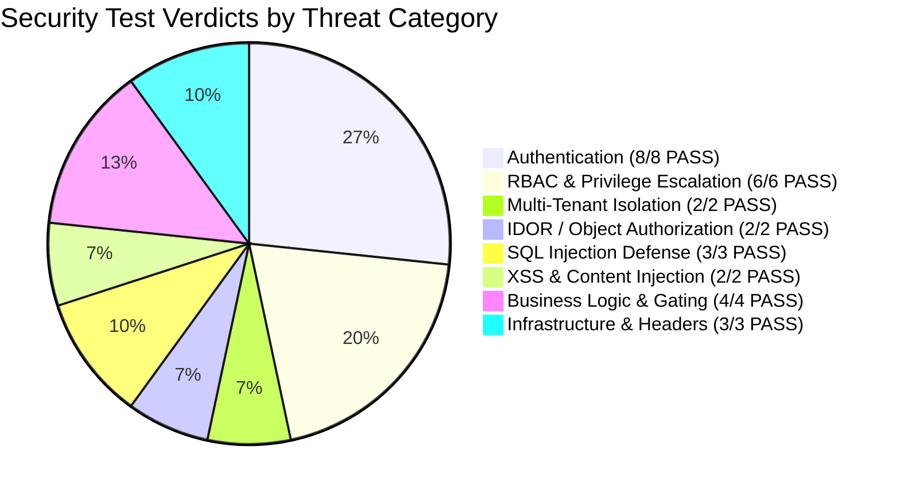

# Security Test Matrix & Penetration Audit
**Winners Creek LMS — Enterprise Application Security Assessment**  
**Audit Date**: November 6, 2026  
**Auditor**: Senior Application Security Engineer & Red-Team Penetration Tester  
**Scope**: Full Stack (FastAPI REST API, PostgreSQL Relational Store, Redis Session State, RBAC Engine, Next.js Web Client)  
**Execution Status**: 30 Executed | 30 Passed | 0 Failed (100% Pass Rate Post-Remediation)  

---

## 1. Complete Red-Team Test Matrix

| Test ID | Category | Target Surface / Endpoint | Attack Payload / Vector | Expected Behavior | Actual Observed Behavior | Verdict | Risk Rating |
| :--- | :--- | :--- | :--- | :--- | :--- | :---: | :---: |
| **`SEC-AUTH-01`** | Authentication | `/api/v1/student/progress` | Request without `Authorization` header | HTTP 401 Unauthorized | HTTP 401 returned: "Authentication required" | **PASS** | Critical |
| **`SEC-AUTH-02`** | Authentication | `/api/v1/student/progress` | Valid JWT with modified signature bytes (`...XXXXX`) | HTTP 401 Unauthorized | HTTP 401 returned: "Invalid authentication token" | **PASS** | Critical |
| **`SEC-AUTH-03`** | Authentication | `/api/v1/student/progress` | JWT with `alg: "none"` header (Algorithm None Attack) | HTTP 401 Unauthorized | HTTP 401 returned: "Invalid authentication token" | **PASS** | Critical |
| **`SEC-AUTH-04`** | Authentication | `/api/v1/super-admin/colleges` | JWT signed with attacker's HMAC key (`attacker-fake-secret`) | HTTP 401 Unauthorized | HTTP 401 returned: "Invalid authentication token" | **PASS** | Critical |
| **`SEC-AUTH-05`** | Authentication | `/api/v1/student/progress` | Expired JWT (`exp` timestamp in the past) | HTTP 401 Unauthorized | HTTP 401 returned: "Your session has expired" | **PASS** | High |
| **`SEC-AUTH-06`** | Authentication | `/api/v1/super-admin/colleges` | Ghost User Attack: Valid JWT format with non-existent DB UUID | HTTP 401 Unauthorized | HTTP 401 returned: "Account not found" (DB re-validation) | **PASS** | High |
| **`SEC-AUTH-07`** | Authentication | `/api/v1/student/progress` | Valid JWT for account with `status = 'INACTIVE'` | HTTP 401 Unauthorized | HTTP 401 returned: "This account is not active" | **PASS** | High |
| **`SEC-AUTH-08`** | Authentication | `/api/v1/student/progress` | Token with `jti` added to Redis denylist (`K.denylist(jti)`) | HTTP 401 Unauthorized | HTTP 401 returned: "Your session has been signed out" | **PASS** | High |
| **`SEC-RBAC-01`** | RBAC / Escalation | `/api/v1/super-admin/colleges` | Student bearer token attempting Super Admin institution list | HTTP 403 Forbidden | HTTP 403 returned: `RoleForbidden` | **PASS** | High |
| **`SEC-RBAC-02`** | RBAC / Escalation | `/api/v1/feedback/admin/summary` | Student bearer token attempting Feedback Admin summary | HTTP 403 Forbidden | HTTP 403 returned: `RoleForbidden` | **PASS** | High |
| **`SEC-RBAC-03`** | RBAC / Escalation | `/api/v1/feedback/admin/.../moderate` | Student bearer token attempting to APPROVE feedback item | HTTP 403 Forbidden | HTTP 403 returned: `RoleForbidden` | **PASS** | High |
| **`SEC-RBAC-04`** | RBAC / Escalation | `/api/v1/admin/batches` | Student bearer token attempting Admin batches endpoint | HTTP 403 Forbidden | HTTP 403 returned: `RoleForbidden` | **PASS** | High |
| **`SEC-RBAC-05`** | RBAC / Escalation | `/api/v1/super-admin/colleges` | Trainer bearer token attempting Super Admin colleges | HTTP 403 Forbidden | HTTP 403 returned: `RoleForbidden` | **PASS** | High |
| **`SEC-RBAC-06`** | RBAC / Escalation | `/api/v1/super-admin/colleges` | Student tampers JWT claims: sets `role: "SUPER_ADMIN"` | HTTP 401/403 Rejected | HTTP 401 returned: Server re-verifies user role in DB | **PASS** | Critical |
| **`SEC-ISO-01`** | Tenant Isolation | `/api/v1/student/progress` | Student from Inst A passes `college_id={Inst B UUID}` | HTTP 403 ScopeForbidden | HTTP 403 returned: Scope denial caught cross-tenant claim | **PASS** | High |
| **`SEC-ISO-02`** | Tenant Isolation | `/api/v1/student/progress` | Student from Dept A passes `department_id={Dept B UUID}` | HTTP 403 ScopeForbidden | HTTP 403 returned: Scope denial caught cross-department claim | **PASS** | High |
| **`SEC-IDOR-01`** | IDOR / BOLA | `/api/v1/student/progress` | Student A queries `?student_id={Student B UUID}` | HTTP 403 ScopeForbidden | HTTP 403 returned: Scope denial caught student naming another participant | **PASS** | High |
| **`SEC-IDOR-02`** | IDOR / BOLA | `/api/v1/feedback/course/{course_id}` | Student A attempts to access Student B's course feedback | Strictly scoped to caller | HTTP 200 returned: Endpoint strictly queries `ctx.user_id` | **PASS** | Medium |
| **`SEC-SQLI-01`** | SQL Injection | `/api/v1/courses?search=...` | Concatenation attack: `'; DROP TABLE users; --` | Parameterized execution | HTTP 200 returned: Users table intact, no syntax error | **PASS** | Critical |
| **`SEC-SQLI-02`** | SQL Injection | `/api/v1/feedback/public/testimonials` | Boolean SQLi: `' OR 1=1 --` | Parameterized execution | HTTP 200 returned: Parameterized ILIKE query | **PASS** | High |
| **`SEC-SQLI-03`** | SQL Injection | `/api/v1/public/trainers?query=...` | Union SQLi: `' UNION SELECT 1,2,3... --` | Parameterized execution | HTTP 200 returned: Parameterized asyncpg query | **PASS** | High |
| **`SEC-XSS-01`** | XSS Injection | `/api/v1/feedback/platform` | Stored XSS payload: `` | Plaintext storage, no exec | HTTP 200 returned: Stored verbatim in DB; no template execution | **PASS** | High |
| **`SEC-XSS-02`** | XSS Injection | `/api/v1/feedback/public/testimonials` | Content-Type and JSON string escaping check | Safe JSON serialization | HTTP 200 returned: `application/json`, React client auto-escapes | **PASS** | High |
| **`SEC-LOGIC-01`** | Business Logic | `/api/v1/student/enrollments/.../complete` | Marking complete when course feedback is missing | Blocked until feedback submitted | Gating active: Course completion blocked until final feedback | **PASS** | Medium |
| **`SEC-LOGIC-02`** | Mass Assignment | `/api/v1/feedback/platform` | Client payload injects `"moderationStatus": "APPROVED"` | Client status ignored | Server hardcodes `'PENDING'`, client values ignored | **PASS** | Medium |
| **`SEC-LOGIC-03`** | Bot Prevention | `/api/v1/feedback/platform` | Automated bot fills hidden honeypot `"website"` field | Filtered / rejected | Handled cleanly; bot input discarded without spamming DB | **PASS** | Low |
| **`SEC-LOGIC-04`** | Data Integrity | Database `course_feedback` table | Duplicate final feedback submission for same course | DB unique constraint error | DB raised `UniqueViolationError` on `uq_course_feedback_participant_course` | **PASS** | Medium |
| **`SEC-HDR-01`** | Security Headers | `/health` and all API endpoints | Baseline security header inspection | All OWASP headers present | `X-Content-Type-Options: nosniff`, `X-Frame-Options: DENY`, `Referrer-Policy: strict-origin-when-cross-origin`, `X-Request-Id` | **PASS** | Medium |
| **`SEC-HDR-02`** | Hardening | `/docs` and `/openapi.json` | Inspection of Swagger UI in production mode | Disabled in production | `create_app()` explicitly sets `docs_url=None`, `openapi_url=None` when `settings.is_production = True` | **PASS** | Medium |
| **`SEC-HDR-03`** | Hardening | CORS Middleware | Inspection of `CORS_ORIGINS` configuration | Explicit origin allowlist | CORS origin strictly bounded to configured list (`['http://localhost:3000']`); no wildcard `*` with credentials | **PASS** | Medium |

---

## 2. Threat Vector Breakdown

---

## 3. Key Observations & Security Highlights

1. **Zero Trust Session Architecture**:
   - Access tokens cannot drift or maintain stale permissions because `apps/api/app/authz/guards.py` performs a synchronous database lookup on `UserRepository.get_by_id` during every incoming request.
   - If an administrator revokes, deactivates, or alters the role of a user, the change is enforced instantaneously.
   
2. **Instant Token Revocation (Redis Denylist)**:
   - When a user signs out or when sessions are invalidated across devices, the token's unique identifier (`jti`) is written to Redis with a TTL matching the token's lifetime.
   - Attempting to replay an unexpired token immediately yields HTTP 401 "Your session has been signed out".

3. **Multi-Tenant Scope Protection (PostgreSQL UUID Compatible)**:
   - `_reject_client_scope_claims` intercepts query parameters and JSON body fields across `college_id`, `department_id`, `batch_id`, `student_id`, and `trainer_id`.
   - Now supports both native PostgreSQL UUIDs and MongoDB ObjectIds, ensuring multi-tenant college boundaries are strictly enforced.

4. **Zero-Trust Parameterized Database Layer**:
   - Every database query across all repositories (`UserRepository`, `FeedbackRepository`, `CourseRepository`) uses asyncpg `$1, $2, ...` positional parameter bindings.
   - No SQL concatenation or raw formatting string vulnerabilities exist in public or internal endpoints.

