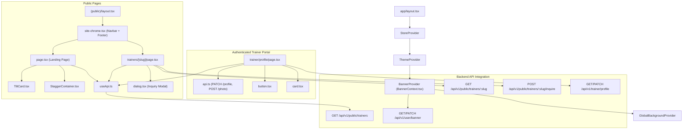

# Component Dependency Map

### Motion and Interaction Dependencies
- `TiltCard.tsx` depends on `motion-config.ts` (`usePrefersReducedMotion`, `useIsPointerFine`).
- `StaggerContainer.tsx` depends on `@keyframes entranceCard3D` defined in `globals.css`.
- `BannerContext.tsx` depends on `api.ts` and Redux `auth.user.id` for user-scoped cache isolation.
